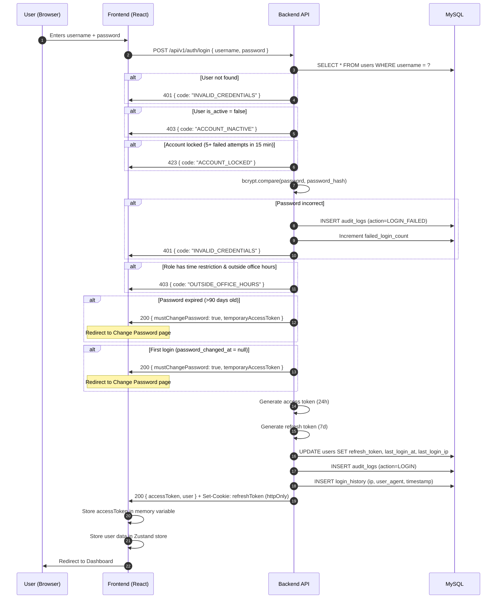
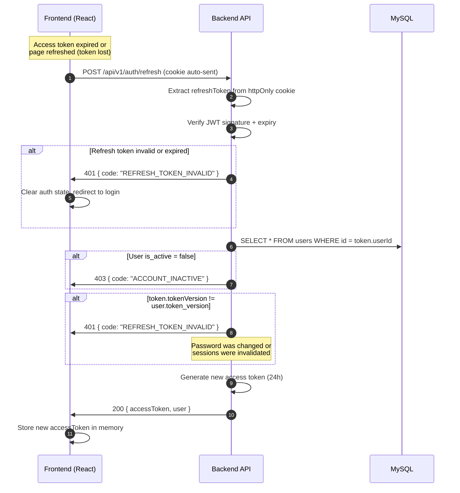
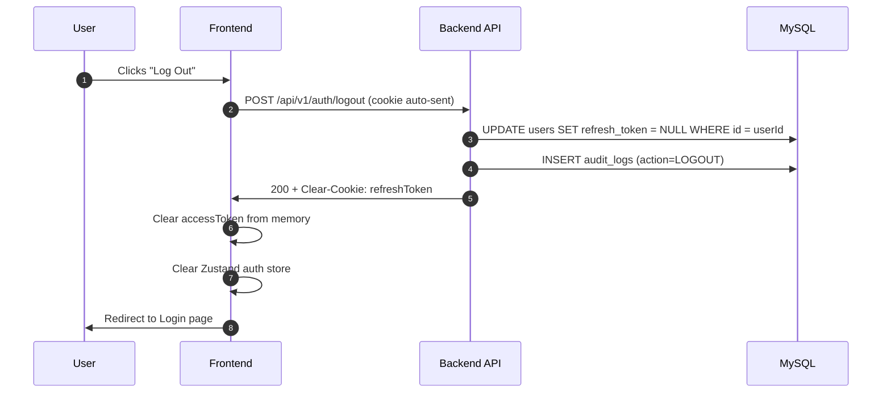
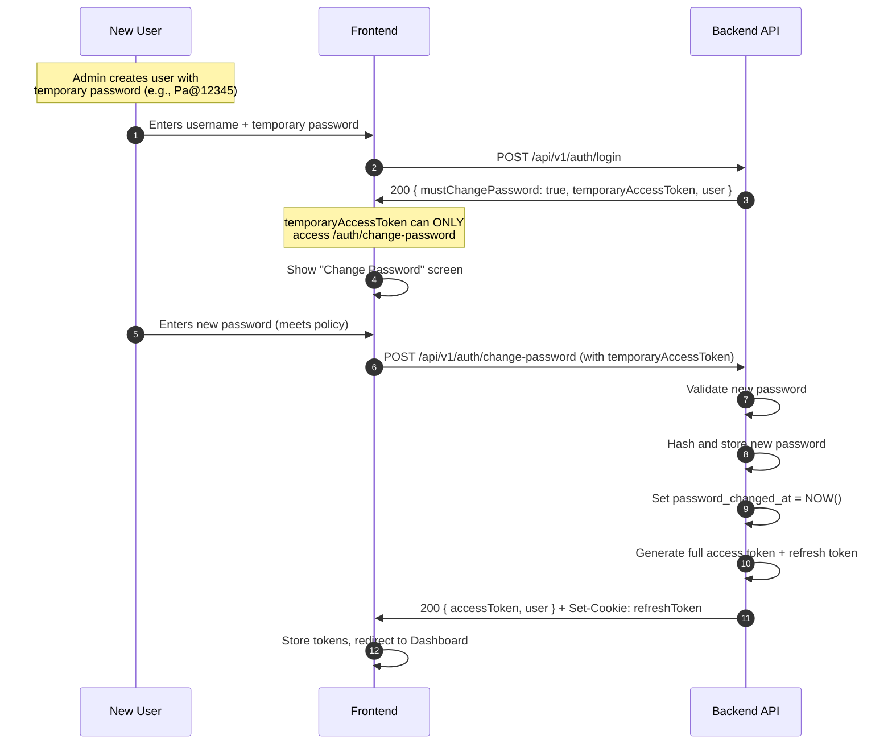
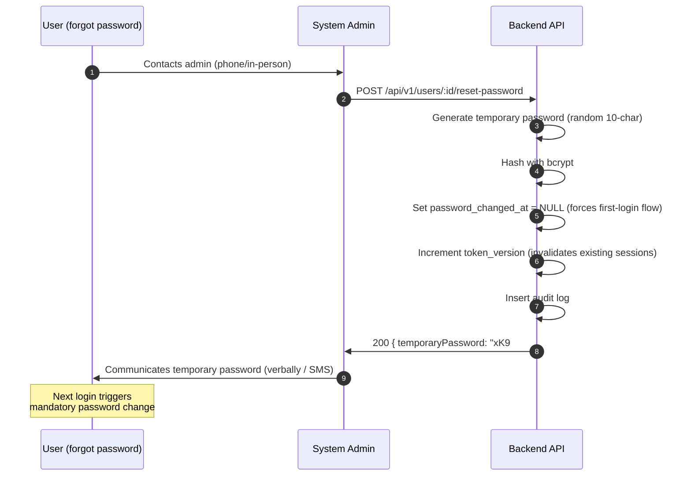
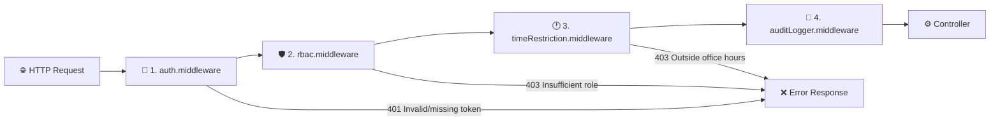
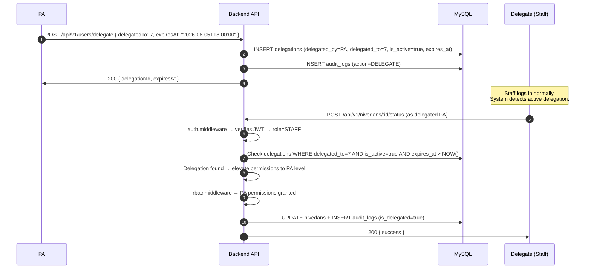

# MLA E-Office — Authentication & Authorization Specification

> **Complete Security Spec — JWT Flow, Password Policy, RBAC, Token Storage, Middleware Chain, Role-Permission Matrix, Time Restrictions, and Delegation**
> 
> *Related Documents:* [USER_ROLES.md](file:///s:/MLA%20E%20-%20Office/USER_ROLES.md) | [API_SPEC.md](file:///s:/MLA%20E%20-%20Office/API_SPEC.md) | [ARCHITECTURE.md](file:///s:/MLA%20E%20-%20Office/ARCHITECTURE.md) | [DATA_MODELS.md](file:///s:/MLA%20E%20-%20Office/DATA_MODELS.md)

---

## 1. Authentication Overview

| Property | Value |
|----------|-------|
| **Method** | JWT (JSON Web Token) |
| **Algorithm** | HS256 (HMAC-SHA256) |
| **Access Token Expiry** | 24 hours |
| **Refresh Token Expiry** | 7 days |
| **Access Token Storage** | In-memory JavaScript variable (frontend) |
| **Refresh Token Storage** | httpOnly, Secure, SameSite=Strict cookie |
| **Password Hashing** | bcrypt (12 salt rounds) |
| **Concurrent Sessions** | Unlimited (no device limit) |
| **Idle Timeout** | None — session lasts until token expiry |
| **Password Reset** | Admin-only (no self-service forgot password) |
| **First Login** | Forced password change |
| **Password Rotation** | Every 90 days |
| **Login History** | Last 5 sessions displayed to user |

---

## 2. Token Architecture

### Token Pair Strategy

The system uses a **dual-token strategy** for security:

```
┌─────────────────────────────────────────────────────────────────┐
│                       TOKEN STRATEGY                            │
├────────────────────────────┬────────────────────────────────────┤
│       ACCESS TOKEN         │         REFRESH TOKEN              │
├────────────────────────────┼────────────────────────────────────┤
│ Short-lived (24 hours)     │ Long-lived (7 days)                │
│ Stored in-memory (JS var)  │ Stored in httpOnly cookie          │
│ Sent via Authorization     │ Sent automatically by browser      │
│   header (Bearer)          │   (cookie)                         │
│ Used for API requests      │ Used ONLY to get new access token  │
│ Lost on page refresh       │ Persists across page refreshes     │
│ Contains user data         │ Contains only user ID              │
│ Never stored in            │ Never accessible by JavaScript     │
│   localStorage/cookies     │   (httpOnly flag)                  │
└────────────────────────────┴────────────────────────────────────┘
```

### Access Token Payload

```json
{
  "header": {
    "alg": "HS256",
    "typ": "JWT"
  },
  "payload": {
    "userId": 2,
    "username": "pa_suresh",
    "role": "PA",
    "modules": [
      "inward", "outward", "nivedan", "visitor", "devworks",
      "karyakarta", "booth", "geography", "calendar", "whatsapp",
      "dashboard", "reports", "notifications"
    ],
    "iat": 1722534000,
    "exp": 1722620400
  }
}
```

### Refresh Token Payload

```json
{
  "payload": {
    "userId": 2,
    "tokenVersion": 3,
    "iat": 1722534000,
    "exp": 1723138800
  }
}
```

> `tokenVersion` increments on each password change or manual session invalidation. If the stored version doesn't match, the refresh is rejected.

### Refresh Token Cookie Settings

```javascript
res.cookie('refreshToken', token, {
  httpOnly: true,       // Not accessible by JavaScript
  secure: true,         // Only sent over HTTPS
  sameSite: 'Strict',   // No cross-site sending
  path: '/api/v1/auth', // Only sent to auth endpoints
  maxAge: 7 * 24 * 60 * 60 * 1000  // 7 days in ms
});
```

---

## 3. Authentication Flows

### 3A. Login Flow



### 3B. Token Refresh Flow (Silent Refresh)



### 3C. Frontend — Axios Interceptor Setup

```javascript
// services/api.js

import axios from 'axios';

const api = axios.create({
  baseURL: import.meta.env.VITE_API_BASE_URL,
  withCredentials: true,  // Send httpOnly cookies
});

let accessToken = null;  // In-memory storage

// Attach access token to every request
api.interceptors.request.use((config) => {
  if (accessToken) {
    config.headers.Authorization = `Bearer ${accessToken}`;
  }
  return config;
});

// Auto-refresh on 401
api.interceptors.response.use(
  (response) => response,
  async (error) => {
    const originalRequest = error.config;
    
    if (error.response?.status === 401 && !originalRequest._retry) {
      originalRequest._retry = true;
      
      try {
        const { data } = await axios.post(
          `${import.meta.env.VITE_API_BASE_URL}/auth/refresh`,
          {},
          { withCredentials: true }
        );
        
        accessToken = data.data.accessToken;
        originalRequest.headers.Authorization = `Bearer ${accessToken}`;
        return api(originalRequest);
      } catch (refreshError) {
        // Refresh failed — redirect to login
        accessToken = null;
        window.location.href = '/login';
        return Promise.reject(refreshError);
      }
    }
    
    return Promise.reject(error);
  }
);

// Called after successful login
export const setAccessToken = (token) => { accessToken = token; };
export const clearAccessToken = () => { accessToken = null; };

export default api;
```

### 3D. Logout Flow



---

## 4. Password Policy

### Password Requirements

| Rule | Requirement |
|------|-------------|
| **Minimum length** | 8 characters |
| **Maximum length** | 128 characters |
| **Uppercase** | At least 1 uppercase letter (A-Z) |
| **Number** | At least 1 digit (0-9) |
| **Special character** | Not required (encouraged) |
| **Prohibited** | Cannot contain username |
| **History** | Cannot reuse last 3 passwords |

### Password Validation Regex

```javascript
// Minimum 8 chars, at least 1 uppercase, at least 1 number
const PASSWORD_REGEX = /^(?=.*[A-Z])(?=.*\d).{8,128}$/;
```

### Password Rotation

| Rule | Value |
|------|-------|
| **Rotation period** | 90 days |
| **Grace period** | 7 days (warning notification before expiry) |
| **Enforcement** | On login: if `password_changed_at` is >90 days ago, return `mustChangePassword: true` |
| **Notification** | In-app notification 7 days before password expires |

### Password Change API

```
POST /api/v1/auth/change-password
```

**Request:**
```json
{
  "currentPassword": "OldPass@123",
  "newPassword": "NewSecure@456"
}
```

**Validation Rules:**
1. `currentPassword` must match stored hash
2. `newPassword` must pass PASSWORD_REGEX
3. `newPassword` must not be same as last 3 passwords (check `password_history` JSON column)
4. `newPassword` must not contain the username

**Success Response (200):**
```json
{
  "success": true,
  "data": {
    "message": "Password changed successfully",
    "mustRelogin": false
  }
}
```

**Backend Actions:**
- Update `password_hash` with new bcrypt hash
- Update `password_changed_at` to `NOW()`
- Push old password hash to `password_history` array (keep last 3)
- Increment `token_version` (invalidates all other refresh tokens)
- Insert audit log (action=UPDATE, module=auth)

---

## 5. First Login Flow



---

## 6. Account Lockout

| Rule | Value |
|------|-------|
| **Max failed attempts** | 5 |
| **Lockout window** | 15 minutes |
| **Lockout scope** | Per username (not per IP) |
| **Unlock** | Automatic after 15 minutes OR Admin manually unlocks |
| **Notification** | In-app alert to Admin after lockout triggers |

### Lockout Implementation

```javascript
// auth.service.js — Login logic

const MAX_ATTEMPTS = 5;
const LOCKOUT_MINUTES = 15;

async function handleFailedLogin(user) {
  const recentAttempts = await AuditLog.count({
    where: {
      userId: user.id,
      action: 'LOGIN_FAILED',
      createdAt: { [Op.gte]: new Date(Date.now() - LOCKOUT_MINUTES * 60 * 1000) }
    }
  });
  
  if (recentAttempts >= MAX_ATTEMPTS) {
    throw new AppError('ACCOUNT_LOCKED', 423, 
      `Account locked. Try after ${LOCKOUT_MINUTES} minutes`);
  }
}
```

---

## 7. Password Reset (Admin Only)

> Users **cannot** reset their own passwords. Only the **System Admin** can reset passwords.

### Reset Flow



**API Endpoint:**

```
POST /api/v1/users/:id/reset-password
```

**Roles:** `ADMIN` only

**Success Response (200):**
```json
{
  "success": true,
  "data": {
    "temporaryPassword": "xK9#mP2qLr",
    "message": "Password reset. User must change on next login."
  }
}
```

---

## 8. Login History

Each user can view their **last 5 login sessions** on their profile page.

### Data Stored Per Login

| Field | Description |
|-------|-------------|
| `user_id` | User who logged in |
| `ip_address` | Client IP (IPv4/IPv6) |
| `user_agent` | Browser/device string |
| `device_type` | Parsed: `Desktop` / `Mobile` / `Tablet` |
| `browser` | Parsed: `Chrome 120` / `Firefox 115` / etc. |
| `login_at` | Timestamp |
| `is_successful` | true/false |

### API Endpoint

```
GET /api/v1/auth/login-history
```

**Success Response (200):**
```json
{
  "success": true,
  "data": [
    {
      "ipAddress": "103.245.67.89",
      "deviceType": "Desktop",
      "browser": "Chrome 120",
      "loginAt": "2026-08-01T04:30:00.000Z",
      "isSuccessful": true
    },
    {
      "ipAddress": "49.36.142.10",
      "deviceType": "Mobile",
      "browser": "Chrome Mobile 120",
      "loginAt": "2026-07-30T10:15:00.000Z",
      "isSuccessful": true
    },
    {
      "ipAddress": "103.245.67.89",
      "deviceType": "Desktop",
      "browser": "Chrome 120",
      "loginAt": "2026-07-30T03:45:00.000Z",
      "isSuccessful": false
    }
  ]
}
```

### Additional `users` Table Columns

These columns are added to the `users` table (supplement to DATA_MODELS.md):

| Column | Type | Description |
|--------|------|-------------|
| `password_changed_at` | DATETIME | NULL = first login required |
| `password_history` | JSON | Array of last 3 password hashes |
| `token_version` | INT DEFAULT 1 | Incremented on password change |
| `failed_login_count` | INT DEFAULT 0 | Resets on successful login |
| `last_failed_login_at` | DATETIME | Tracks lockout window |

### `login_history` Table (New)

| Column | Type | Key / Notes |
|--------|------|-------------|
| `id` | INT | 🔑 PK, auto-increment |
| `user_id` | INT | 🔗 FK → `users.id`, 🔍 Index |
| `ip_address` | VARCHAR(45) | |
| `user_agent` | VARCHAR(500) | Raw browser string |
| `device_type` | ENUM('DESKTOP','MOBILE','TABLET') | Parsed |
| `browser` | VARCHAR(100) | Parsed from user_agent |
| `is_successful` | BOOLEAN | true = login succeeded |
| `created_at` | DATETIME | Login attempt timestamp |

---

## 9. Role-Based Access Control (RBAC)

### 9A. Middleware Chain

Every protected API request passes through 4 middleware layers in sequence:

```
Request ──▶ [1. Auth] ──▶ [2. RBAC] ──▶ [3. Time] ──▶ [4. Audit] ──▶ Controller
```



### Layer 1: `auth.middleware.js`

**Purpose:** Verify JWT access token, extract user identity.

```javascript
// middlewares/auth.middleware.js

const jwt = require('jsonwebtoken');

const authMiddleware = (req, res, next) => {
  const authHeader = req.headers.authorization;
  
  if (!authHeader || !authHeader.startsWith('Bearer ')) {
    return res.status(401).json({
      success: false,
      error: { code: 'TOKEN_MISSING', message: 'No auth token provided', statusCode: 401 }
    });
  }
  
  const token = authHeader.split(' ')[1];
  
  try {
    const decoded = jwt.verify(token, process.env.JWT_SECRET);
    req.user = {
      userId: decoded.userId,
      username: decoded.username,
      role: decoded.role,
      modules: decoded.modules
    };
    next();
  } catch (err) {
    return res.status(401).json({
      success: false,
      error: { code: 'TOKEN_EXPIRED', message: 'Access token has expired', statusCode: 401 }
    });
  }
};
```

### Layer 2: `rbac.middleware.js`

**Purpose:** Check if the user's role has permission for this route.

```javascript
// middlewares/rbac.middleware.js

const authorize = (...allowedRoles) => {
  return (req, res, next) => {
    if (!req.user || !allowedRoles.includes(req.user.role)) {
      return res.status(403).json({
        success: false,
        error: { code: 'FORBIDDEN', message: 'Insufficient permissions', statusCode: 403 }
      });
    }
    next();
  };
};

// Usage in routes:
// router.post('/nivedans', auth, authorize('PA', 'RECEPTIONIST'), nivedanController.create);
```

### Layer 3: `timeRestriction.middleware.js`

**Purpose:** Enforce office-hours access for time-restricted roles.

```javascript
// middlewares/timeRestriction.middleware.js

const TIME_RESTRICTED_ROLES = ['RECEPTIONIST', 'AUDITOR'];

const timeRestriction = (req, res, next) => {
  if (!TIME_RESTRICTED_ROLES.includes(req.user.role)) {
    return next(); // MLA, PA, ADMIN bypass time check
  }
  
  const now = new Date().toLocaleString('en-US', { timeZone: process.env.TIMEZONE });
  const currentHour = new Date(now).getHours();
  const currentMinute = new Date(now).getMinutes();
  const currentTime = currentHour * 60 + currentMinute;
  
  const [startH, startM] = process.env.OFFICE_HOURS_START.split(':').map(Number);
  const [endH, endM] = process.env.OFFICE_HOURS_END.split(':').map(Number);
  const startTime = startH * 60 + startM;  // e.g., 600 (10:00 AM)
  const endTime = endH * 60 + endM;        // e.g., 1080 (6:00 PM)
  
  if (currentTime < startTime || currentTime > endTime) {
    return res.status(403).json({
      success: false,
      error: {
        code: 'OUTSIDE_OFFICE_HOURS',
        message: `Access restricted to office hours (${process.env.OFFICE_HOURS_START} – ${process.env.OFFICE_HOURS_END})`,
        statusCode: 403
      }
    });
  }
  
  next();
};
```

### Layer 4: `auditLogger.middleware.js`

**Purpose:** Auto-log every data mutation (POST, PATCH, DELETE) to the audit trail.

```javascript
// middlewares/auditLogger.middleware.js

const AUDIT_METHODS = ['POST', 'PATCH', 'PUT', 'DELETE'];

const auditLogger = (req, res, next) => {
  if (!AUDIT_METHODS.includes(req.method)) {
    return next();
  }
  
  // Capture original response to get result data
  const originalJson = res.json.bind(res);
  
  res.json = (body) => {
    if (body.success && req.user) {
      AuditLog.create({
        userId: req.user.userId,
        action: methodToAction(req.method),
        module: extractModule(req.path),
        entityType: extractEntityType(req.path),
        entityId: req.params.id || body.data?.id,
        oldValues: req._auditOldValues || null,
        newValues: req.body,
        ipAddress: req.ip,
        userAgent: req.headers['user-agent'],
        isDelegated: req.user.isDelegated || false
      }).catch(console.error);
    }
    return originalJson(body);
  };
  
  next();
};
```

---

### 9B. Route-Level Permission Map

| Module | Endpoint Pattern | MLA | PA | REC | AUD | B.P. | ADM |
|--------|-----------------|:---:|:---:|:---:|:---:|:---:|:---:|
| **Auth** | `/auth/*` | ✅ | ✅ | ✅ | ✅ | ✅ | ✅ |
| **Inward** — List | `GET /inward` | ✅ | ✅ | 👁️ | ❌ | ❌ | ❌ |
| **Inward** — Create | `POST /inward` | ❌ | ✅ | ✅ | ❌ | ❌ | ❌ |
| **Inward** — Update | `PATCH /inward/:id` | ❌ | ✅ | ❌ | ❌ | ❌ | ❌ |
| **Inward** — Assign | `PATCH /inward/:id/assign` | ❌ | ✅ | ❌ | ❌ | ❌ | ❌ |
| **Outward** — List | `GET /outward` | ✅ | ✅ | ❌ | ❌ | ❌ | ❌ |
| **Outward** — Create | `POST /outward` | ❌ | ✅ | ❌ | ❌ | ❌ | ❌ |
| **Outward** — AI Draft | `POST /outward/ai-draft` | ❌ | ✅ | ❌ | ❌ | ❌ | ❌ |
| **Nivedan** — List | `GET /nivedans` | ✅ | ✅ | 👁️ | 👁️ | ❌ | ❌ |
| **Nivedan** — Create | `POST /nivedans` | ❌ | ✅ | ✅ | ❌ | ❌ | ❌ |
| **Nivedan** — Status | `PATCH /nivedans/:id/status` | ❌ | ✅ | ❌ | ❌ | ❌ | ❌ |
| **Nivedan** — Assign | `PATCH /nivedans/:id/assign` | ❌ | ✅ | ❌ | ❌ | ❌ | ❌ |
| **Nivedan** — Notes | `POST /nivedans/:id/notes` | ❌ | ✅ | ❌ | ❌ | ❌ | ❌ |
| **Visitor** — List | `GET /visitors` | ✅ | ✅ | 👁️ | ❌ | ❌ | ❌ |
| **Visitor** — Create | `POST /visitors` | ❌ | ✅ | ✅ | ❌ | ❌ | ❌ |
| **DevWorks** — List | `GET /devworks` | ✅ | ✅ | ❌ | ✅ | ❌ | ❌ |
| **DevWorks** — Create | `POST /devworks` | ❌ | ✅ | ❌ | ❌ | ❌ | ❌ |
| **DevWorks** — Photos | `POST /devworks/:id/photos` | ❌ | ✅ | ❌ | ✅ | ❌ | ❌ |
| **Karyakarta** — List | `GET /karyakartas` | ✅ | ✅ | ❌ | ❌ | ❌ | ❌ |
| **Karyakarta** — Create | `POST /karyakartas` | ❌ | ✅ | ❌ | ❌ | 👁️ | ❌ |
| **Karyakarta** — Import | `POST /karyakartas/bulk-import` | ❌ | ✅ | ❌ | ❌ | ❌ | ❌ |
| **Booth** — List | `GET /booths` | ✅ | ✅ | ❌ | ✅ | ❌ | ❌ |
| **Booth** — Verify | `POST /booths/:id/verify` | ❌ | ❌ | ❌ | ✅ | ❌ | ❌ |
| **Calendar** — View | `GET /calendar` | ✅ | ✅ | ✅ | ✅ | ❌ | ❌ |
| **Calendar** — Create | `POST /calendar` | ✅ | ✅ | ❌ | ❌ | ❌ | ❌ |
| **WhatsApp** — Broadcast | `POST /whatsapp/broadcast` | ❌ | ✅ | ❌ | ❌ | ❌ | ❌ |
| **WhatsApp** — Logs | `GET /whatsapp/logs` | ✅ | ✅ | ❌ | ❌ | ❌ | ❌ |
| **Dashboard** | `GET /dashboard/*` | ✅ | ✅ | ❌ | ❌ | ❌ | ❌ |
| **Reports** | `POST /reports/*` | ✅ | ✅ | ❌ | ❌ | ❌ | ❌ |
| **Users** — Manage | `* /users/*` | ❌ | ❌ | ❌ | ❌ | ❌ | ✅ |
| **Users** — View | `GET /users` | ✅ | ❌ | ❌ | ❌ | ❌ | ✅ |
| **Audit Logs** | `GET /audit-logs` | ✅ | ❌ | ❌ | ❌ | ❌ | ✅ |
| **Search** | `GET /search` | ✅ | ✅ | ✅ | ✅ | ❌ | ❌ |
| **Notifications** | `* /notifications/*` | ✅ | ✅ | ✅ | ✅ | ❌ | ✅ |
| **Geography** — View | `GET /geography/*` | ✅ | ✅ | ✅ | ✅ | ❌ | ✅ |
| **Geography** — Import | `POST /geography/bulk-import` | ❌ | ✅ | ❌ | ❌ | ❌ | ✅ |
| **Public Track** | `GET /public/track/:id` | 🌐 | 🌐 | 🌐 | 🌐 | 🌐 | 🌐 |

**Legend:** ✅ Full access | 👁️ Own data only | 🌐 No auth required | ❌ No access

---

### 9C. Data Scoping Rules

Beyond route access, certain roles see only a **subset** of data:

| Role | Scoping Rule |
|------|-------------|
| **MLA** | Sees everything across the entire system |
| **PA** | Sees everything across the entire system |
| **Receptionist** | Sees only records **they created** (`created_by = currentUserId`) |
| **Auditor** | Sees only records **assigned to them** (`assigned_to_user_id = currentUserId`) or dev works they're inspecting |
| **Booth Pramukh** | Can only add/view karyakartas in **their own booth** (`booth_id = currentUserBoothId`) |
| **Admin** | Can manage users and view system logs. **No access** to operational data (nivedans, visitors, etc.) |

**Implementation:**

```javascript
// In nivedan.service.js — list method
const buildWhereClause = (user, filters) => {
  const where = { ...filters };
  
  if (user.role === 'RECEPTIONIST') {
    where.created_by = user.userId;  // Only own nivedans
  }
  
  if (user.role === 'AUDITOR') {
    where.assigned_to_user_id = user.userId;  // Only assigned
  }
  
  return where;
};
```

---

## 10. Time-Based Access Restrictions

| Role | Access Hours | Days |
|------|-------------|------|
| **MLA** | 24/7 (unrestricted) | All days |
| **PA** | 24/7 (unrestricted) | All days |
| **Receptionist** | 10:00 AM – 6:00 PM IST | Mon–Sat |
| **Auditor** | 10:00 AM – 6:00 PM IST | Mon–Sat |
| **Admin** | 24/7 (unrestricted) | All days |
| **Booth Pramukh** | N/A (WhatsApp only) | All days |

> **Configurable:** Office hours are set in `.env` (`OFFICE_HOURS_START`, `OFFICE_HOURS_END`) and can be changed per installation.

---

## 11. PA Delegation

When the PA is absent, they can **delegate their permissions** to another staff member temporarily.

### Delegation Flow



### Delegation Rules

| Rule | Value |
|------|-------|
| **Who can delegate** | PA only |
| **Max duration** | 3 days (72 hours) |
| **Auto-expire** | Yes — delegation ends at `expires_at` |
| **Manual revoke** | PA can revoke anytime via `PATCH /users/delegate/:id/revoke` |
| **Audit** | All actions by delegate are marked `is_delegated = true` in audit logs |
| **Concurrent** | Only 1 active delegation at a time |
| **Notification** | MLA receives notification when PA delegates |

---

## 12. Security Headers

Applied via `helmet` middleware to all responses:

```javascript
// app.js
const helmet = require('helmet');

app.use(helmet({
  contentSecurityPolicy: {
    directives: {
      defaultSrc: ["'self'"],
      scriptSrc: ["'self'"],
      styleSrc: ["'self'", "'unsafe-inline'", "fonts.googleapis.com"],
      fontSrc: ["'self'", "fonts.gstatic.com"],
      imgSrc: ["'self'", "res.cloudinary.com", "data:"],
      connectSrc: ["'self'", process.env.FRONTEND_URL],
    }
  },
  crossOriginResourcePolicy: { policy: "cross-origin" },
  referrerPolicy: { policy: "strict-origin-when-cross-origin" }
}));
```

### CORS Configuration

```javascript
// app.js
const cors = require('cors');

app.use(cors({
  origin: process.env.FRONTEND_URL,   // Only frontend domain
  credentials: true,                   // Allow httpOnly cookies
  methods: ['GET', 'POST', 'PATCH', 'PUT', 'DELETE'],
  allowedHeaders: ['Content-Type', 'Authorization'],
  maxAge: 86400                        // Preflight cache: 24 hours
}));
```

---

## 13. Frontend RBAC Hook

```javascript
// hooks/usePermission.js

import { useAuthStore } from '../store/authStore';

const ROLE_PERMISSIONS = {
  MLA: {
    modules: ['dashboard', 'inward', 'outward', 'nivedan', 'visitor', 'devworks', 
              'karyakarta', 'booth', 'geography', 'calendar', 'whatsapp', 'reports', 
              'notifications', 'audit'],
    actions: ['view', 'export']
  },
  PA: {
    modules: ['dashboard', 'inward', 'outward', 'nivedan', 'visitor', 'devworks',
              'karyakarta', 'booth', 'geography', 'calendar', 'whatsapp', 'reports',
              'notifications'],
    actions: ['view', 'create', 'edit', 'assign', 'forward', 'resolve', 'broadcast', 'export', 'delegate']
  },
  RECEPTIONIST: {
    modules: ['inward', 'nivedan', 'visitor', 'calendar', 'notifications'],
    actions: ['view_own', 'create']
  },
  AUDITOR: {
    modules: ['devworks', 'booth', 'calendar', 'notifications'],
    actions: ['view_assigned', 'verify', 'upload_photos']
  },
  ADMIN: {
    modules: ['users', 'audit', 'notifications'],
    actions: ['view', 'create', 'edit', 'reset_password', 'deactivate']
  }
};

export const usePermission = () => {
  const { user } = useAuthStore();
  
  const canAccess = (module) => {
    return ROLE_PERMISSIONS[user.role]?.modules.includes(module) || false;
  };
  
  const canPerform = (action) => {
    return ROLE_PERMISSIONS[user.role]?.actions.includes(action) || false;
  };
  
  const isRole = (...roles) => roles.includes(user?.role);
  
  return { canAccess, canPerform, isRole, role: user?.role };
};

// Usage in components:
// const { canAccess, canPerform } = usePermission();
// if (canAccess('nivedan')) { /* show nivedan menu */ }
// if (canPerform('create')) { /* show create button */ }
```

---

## 14. Protected Route Wrapper (Frontend)

```javascript
// router/ProtectedRoute.jsx

import { Navigate } from 'react-router-dom';
import { useAuthStore } from '../store/authStore';
import { usePermission } from '../hooks/usePermission';

const ProtectedRoute = ({ children, module, roles }) => {
  const { isAuthenticated, user } = useAuthStore();
  const { canAccess, isRole } = usePermission();
  
  // Not logged in → redirect to login
  if (!isAuthenticated) {
    return <Navigate to="/login" replace />;
  }
  
  // Must change password → redirect to change-password
  if (user.mustChangePassword) {
    return <Navigate to="/change-password" replace />;
  }
  
  // Module access check
  if (module && !canAccess(module)) {
    return <Navigate to="/unauthorized" replace />;
  }
  
  // Specific role check
  if (roles && !isRole(...roles)) {
    return <Navigate to="/unauthorized" replace />;
  }
  
  return children;
};

// Usage in router:
// <Route path="/nivedans" element={
//   <ProtectedRoute module="nivedan">
//     <NivedanListPage />
//   </ProtectedRoute>
// } />
```

---

## 15. Security Summary

```
┌───────────────────────────────────────────────────────────────────┐
│                    SECURITY SUMMARY                               │
├───────────────────────────────────────────────────────────────────┤
│                                                                   │
│  🔐 Auth Method       JWT (HS256) — dual token strategy           │
│  🍪 Refresh Token     httpOnly + Secure + SameSite=Strict cookie  │
│  💾 Access Token      In-memory JS variable (not localStorage)    │
│  ⏱️ Access Expiry     24 hours                                    │
│  🔄 Refresh Expiry    7 days                                      │
│  🔑 Password Hash     bcrypt (12 salt rounds)                     │
│  📏 Password Policy   Min 8 chars, 1 uppercase, 1 number          │
│  🔁 Password Rotation Every 90 days                               │
│  🚪 First Login       Forced password change                      │
│  🔒 Account Lockout   5 failed attempts → 15 min lockout          │
│  🔧 Password Reset    Admin-only (no self-service)                │
│  📱 Concurrent        Unlimited sessions                          │
│  ⏰ Idle Timeout      None (token-based expiry)                   │
│  🛡️ RBAC             4-layer middleware chain                     │
│  🕐 Time Restriction  Office hours for Receptionist, Auditor      │
│  🤝 Delegation        PA → Staff (max 3 days, auto-expire)        │
│  📋 Login History     Last 5 sessions (IP, device, time)          │
│  🔒 HTTPS            Mandatory (auto-provisioned)                 │
│  🛡️ CORS             Whitelist frontend domain only               │
│  🪖 Helmet           CSP, XSS, referrer headers                   │
│  🚫 No Delete        Soft delete only — archive/cancel             │
│  📝 Audit Trail      Every mutation logged with old/new values     │
│                                                                   │
└───────────────────────────────────────────────────────────────────┘
```

---
