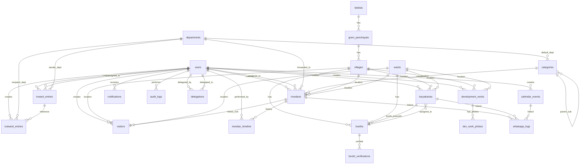

# MLA E-Office — Data Models & Database Schema

> **Complete MySQL Database Schema — Tables, Columns, Types, Constraints, Relationships, and Indexes**
> 
> *Related Documents:* [ARCHITECTURE.md](file:///s:/MLA%20E%20-%20Office/ARCHITECTURE.md) | [PROJECT_SECTIONS_BREAKDOWN.md](file:///s:/MLA%20E%20-%20Office/PROJECT_SECTIONS_BREAKDOWN.md) | [GLOSSARY.md](file:///s:/MLA%20E%20-%20Office/GLOSSARY.md) | [TECH_STACK.md](file:///s:/MLA%20E%20-%20Office/TECH_STACK.md)

---

## 1. Database Overview

| Property | Value |
|----------|-------|
| **Engine** | MySQL 8.x |
| **ORM** | Sequelize v6 |
| **Charset** | `utf8mb4` (supports Marathi, emoji, special characters) |
| **Collation** | `utf8mb4_unicode_ci` |
| **Primary Keys** | Auto-increment integers (internal). Public-facing IDs use formatted strings (`NIV-2026-00001`, `INW/2026/0001`). |
| **Soft Delete** | Varies per table — nivedans use `status` enum, users use `is_active` boolean, etc. |
| **Timestamps** | `created_at` and `updated_at` on main operational tables (not on lookup/master tables). |
| **Audit Tracking** | `created_by` and `updated_by` on main operational tables. |
| **Timezone** | All timestamps stored in UTC; displayed in IST (Asia/Kolkata) on frontend. |

---

## 2. Table Summary

### Operational Tables (13)

| # | Table Name | Description | Soft Delete Strategy |
|:-:|-----------|-------------|---------------------|
| 1 | `users` | System user accounts | `is_active` boolean |
| 2 | `inward_entries` | Incoming letters/documents | `status` enum (includes Cancelled) |
| 3 | `outward_entries` | Outgoing letters | No delete needed (permanent record) |
| 4 | `nivedans` | Citizen complaints & petitions | `status` enum (Cancelled/Archived) |
| 5 | `nivedan_timeline` | Activity history per nivedan | No delete (append-only log) |
| 6 | `visitors` | Office visitor register | No delete needed (permanent record) |
| 7 | `development_works` | Infrastructure projects | `status` enum (includes Cancelled) |
| 8 | `dev_work_photos` | Geotagged project photos | `is_active` boolean |
| 9 | `karyakartas` | Party worker directory | `is_active` boolean |
| 10 | `calendar_events` | Office schedule & events | `is_cancelled` boolean |
| 11 | `whatsapp_logs` | Message delivery records | No delete (permanent log) |
| 12 | `notifications` | In-app notifications | `is_read` boolean (no delete) |
| 13 | `audit_logs` | System activity audit trail | No delete (permanent, append-only) |

### Lookup / Master Tables (9)

| # | Table Name | Description |
|:-:|-----------|-------------|
| 14 | `categories` | Nivedan complaint categories & sub-categories |
| 15 | `departments` | Government department directory |
| 16 | `talukas` | Taluka master data |
| 17 | `gram_panchayats` | Gram panchayat master data |
| 18 | `villages` | Village master data |
| 19 | `wards` | City ward master data |
| 20 | `booths` | Polling booth master data |
| 21 | `booth_verifications` | Booth verification reports |
| 22 | `delegations` | PA delegation records |

**Total: 22 tables**

---

## 3. Detailed Table Schemas

### Legend

| Symbol | Meaning |
|--------|---------|
| 🔑 | Primary Key |
| 🔗 | Foreign Key |
| ✅ | NOT NULL (required) |
| ❌ | NULL allowed (optional) |
| 🔍 | Indexed column |
| 📎 | Unique constraint |
| ⚡ | Auto-generated |
| 🔤 | FULLTEXT index (for search) |

---

### Table 1: `users`

> System user accounts — MLA, PA, Receptionist, Auditor, Admin, etc.

| Column | Type | Null | Default | Key / Notes |
|--------|------|:----:|---------|-------------|
| `id` | INT | ✅ | Auto-increment | 🔑 Primary Key |
| `full_name` | VARCHAR(150) | ✅ | — | 🔤 FULLTEXT |
| `username` | VARCHAR(50) | ✅ | — | 📎 Unique, 🔍 Index |
| `password_hash` | VARCHAR(255) | ✅ | — | bcrypt hashed |
| `role` | ENUM('MLA','PA','RECEPTIONIST','AUDITOR','BOOTH_PRAMUKH','CITIZEN','ADMIN') | ✅ | — | 🔍 Index |
| `mobile` | VARCHAR(15) | ✅ | — | 📎 Unique |
| `email` | VARCHAR(150) | ❌ | NULL | |
| `profile_photo_url` | VARCHAR(500) | ❌ | NULL | Cloudinary URL |
| `accessible_modules` | JSON | ❌ | NULL | Array of module names the user can access |
| `is_active` | BOOLEAN | ✅ | `true` | 🔍 Index. `false` = soft-deactivated |
| `last_login_at` | DATETIME | ❌ | NULL | Last successful login timestamp |
| `last_login_ip` | VARCHAR(45) | ❌ | NULL | IPv4 or IPv6 |
| `refresh_token` | VARCHAR(500) | ❌ | NULL | Current valid refresh token |
| `created_at` | DATETIME | ✅ | `CURRENT_TIMESTAMP` | ⚡ Auto |
| `updated_at` | DATETIME | ✅ | `CURRENT_TIMESTAMP ON UPDATE` | ⚡ Auto |

---

### Table 2: `inward_entries`

> Incoming letters, applications, and documents received at the MLA office.

| Column | Type | Null | Default | Key / Notes |
|--------|------|:----:|---------|-------------|
| `id` | INT | ✅ | Auto-increment | 🔑 Primary Key |
| `inward_number` | VARCHAR(20) | ✅ | — | 📎 Unique, 🔍 Index. ⚡ Auto: `INW/YYYY/NNNN` |
| `date_received` | DATE | ✅ | `CURDATE()` | 🔍 Index |
| `sender_name` | VARCHAR(200) | ✅ | — | 🔤 FULLTEXT |
| `sender_designation` | VARCHAR(200) | ❌ | NULL | |
| `sender_department_id` | INT | ❌ | NULL | 🔗 FK → `departments.id` |
| `subject` | VARCHAR(500) | ✅ | — | 🔤 FULLTEXT |
| `description` | TEXT | ❌ | NULL | |
| `tags` | JSON | ❌ | NULL | Array of string tags (e.g., ["Water","Urgent"]) |
| `priority` | ENUM('HIGH','MEDIUM','LOW') | ✅ | `'MEDIUM'` | 🔍 Index |
| `attachment_urls` | JSON | ❌ | NULL | Array of Cloudinary URLs |
| `assigned_to_user_id` | INT | ❌ | NULL | 🔗 FK → `users.id`. 🔍 Index |
| `status` | ENUM('PENDING','ASSIGNED','IN_PROGRESS','COMPLETED','CANCELLED') | ✅ | `'PENDING'` | 🔍 Index |
| `created_by` | INT | ✅ | — | 🔗 FK → `users.id` |
| `updated_by` | INT | ❌ | NULL | 🔗 FK → `users.id` |
| `created_at` | DATETIME | ✅ | `CURRENT_TIMESTAMP` | ⚡ Auto |
| `updated_at` | DATETIME | ✅ | `CURRENT_TIMESTAMP ON UPDATE` | ⚡ Auto |

**Indexes:**
- `idx_inward_date` on (`date_received`)
- `idx_inward_status` on (`status`)
- `idx_inward_assigned` on (`assigned_to_user_id`)
- `idx_inward_created_by` on (`created_by`)
- `FULLTEXT idx_inward_search` on (`sender_name`, `subject`)

---

### Table 3: `outward_entries`

> Outgoing letters and correspondence sent from the MLA office.

| Column | Type | Null | Default | Key / Notes |
|--------|------|:----:|---------|-------------|
| `id` | INT | ✅ | Auto-increment | 🔑 Primary Key |
| `outward_number` | VARCHAR(20) | ✅ | — | 📎 Unique, 🔍 Index. ⚡ Auto: `OUT/YYYY/NNNN` |
| `date_sent` | DATE | ✅ | `CURDATE()` | 🔍 Index |
| `recipient_name` | VARCHAR(200) | ✅ | — | 🔤 FULLTEXT |
| `recipient_designation` | VARCHAR(200) | ❌ | NULL | |
| `recipient_department_id` | INT | ❌ | NULL | 🔗 FK → `departments.id` |
| `subject` | VARCHAR(500) | ✅ | — | 🔤 FULLTEXT |
| `body_text` | TEXT | ✅ | — | Full letter body content |
| `letter_pdf_url` | VARCHAR(500) | ❌ | NULL | Cloudinary URL of finalized PDF |
| `reference_inward_id` | INT | ❌ | NULL | 🔗 FK → `inward_entries.id` |
| `is_ai_drafted` | BOOLEAN | ✅ | `false` | Whether AI generated the draft |
| `attachment_urls` | JSON | ❌ | NULL | Array of Cloudinary URLs |
| `approved_by` | INT | ❌ | NULL | 🔗 FK → `users.id` (PA who finalized) |
| `created_by` | INT | ✅ | — | 🔗 FK → `users.id` |
| `created_at` | DATETIME | ✅ | `CURRENT_TIMESTAMP` | ⚡ Auto |
| `updated_at` | DATETIME | ✅ | `CURRENT_TIMESTAMP ON UPDATE` | ⚡ Auto |

**Indexes:**
- `idx_outward_date` on (`date_sent`)
- `idx_outward_ref_inward` on (`reference_inward_id`)
- `FULLTEXT idx_outward_search` on (`recipient_name`, `subject`)

---

### Table 4: `nivedans`

> Citizen complaints and petitions — the most critical table in the system.

| Column | Type | Null | Default | Key / Notes |
|--------|------|:----:|---------|-------------|
| `id` | INT | ✅ | Auto-increment | 🔑 Primary Key |
| `tracking_id` | VARCHAR(20) | ✅ | — | 📎 Unique, 🔍 Index. ⚡ Auto: `NIV-YYYY-NNNNN` |
| `citizen_name` | VARCHAR(200) | ✅ | — | 🔤 FULLTEXT |
| `citizen_mobile` | VARCHAR(15) | ✅ | — | 🔍 Index (for citizen history lookup) |
| `citizen_address_line` | VARCHAR(500) | ✅ | — | |
| `citizen_city` | VARCHAR(100) | ❌ | NULL | |
| `citizen_pincode` | VARCHAR(10) | ❌ | NULL | |
| `citizen_state` | VARCHAR(50) | ❌ | `'Maharashtra'` | |
| `citizen_dob` | DATE | ❌ | NULL | Optional — for birthday greetings |
| `village_id` | INT | ❌ | NULL | 🔗 FK → `villages.id` |
| `ward_id` | INT | ❌ | NULL | 🔗 FK → `wards.id` |
| `taluka_id` | INT | ❌ | NULL | 🔗 FK → `talukas.id` |
| `category_id` | INT | ✅ | — | 🔗 FK → `categories.id`. 🔍 Index |
| `sub_category_id` | INT | ❌ | NULL | 🔗 FK → `categories.id` (parent_id based) |
| `subject` | VARCHAR(500) | ✅ | — | 🔤 FULLTEXT |
| `description` | TEXT | ✅ | — | |
| `attachment_urls` | JSON | ❌ | NULL | Array of Cloudinary URLs |
| `status` | ENUM('PENDING','IN_PROGRESS','FORWARDED','AWAITING_RESPONSE','RESOLVED','REJECTED','CANCELLED','ARCHIVED') | ✅ | `'PENDING'` | 🔍 Index |
| `priority` | ENUM('HIGH','MEDIUM','LOW') | ✅ | `'MEDIUM'` | 🔍 Index. Auto-set by category or manual override. |
| `assigned_to_user_id` | INT | ❌ | NULL | 🔗 FK → `users.id`. 🔍 Index |
| `department_forwarded_to_id` | INT | ❌ | NULL | 🔗 FK → `departments.id` |
| `resolution_notes` | TEXT | ❌ | NULL | Staff notes when resolving |
| `escalation_level` | ENUM('NONE','LEVEL_1','LEVEL_2') | ✅ | `'NONE'` | 🔍 Index |
| `escalated_at` | DATETIME | ❌ | NULL | When escalation was triggered |
| `whatsapp_notified` | BOOLEAN | ✅ | `false` | Whether acknowledgment was sent |
| `linked_visitor_id` | INT | ❌ | NULL | 🔗 FK → `visitors.id` |
| `resolved_at` | DATETIME | ❌ | NULL | Timestamp of resolution |
| `created_by` | INT | ✅ | — | 🔗 FK → `users.id` |
| `updated_by` | INT | ❌ | NULL | 🔗 FK → `users.id` |
| `created_at` | DATETIME | ✅ | `CURRENT_TIMESTAMP` | ⚡ Auto. 🔍 Index |
| `updated_at` | DATETIME | ✅ | `CURRENT_TIMESTAMP ON UPDATE` | ⚡ Auto |

**Indexes:**
- `idx_nivedan_tracking` on (`tracking_id`) — UNIQUE
- `idx_nivedan_mobile` on (`citizen_mobile`) — for citizen history lookup
- `idx_nivedan_status` on (`status`)
- `idx_nivedan_category` on (`category_id`)
- `idx_nivedan_assigned` on (`assigned_to_user_id`)
- `idx_nivedan_priority` on (`priority`)
- `idx_nivedan_escalation` on (`escalation_level`)
- `idx_nivedan_created_at` on (`created_at`)
- `idx_nivedan_village` on (`village_id`)
- `idx_nivedan_ward` on (`ward_id`)
- `idx_nivedan_created_by` on (`created_by`)
- `FULLTEXT idx_nivedan_search` on (`citizen_name`, `subject`)

---

### Table 5: `nivedan_timeline`

> Activity history log for each nivedan — every action, status change, and internal note.

| Column | Type | Null | Default | Key / Notes |
|--------|------|:----:|---------|-------------|
| `id` | INT | ✅ | Auto-increment | 🔑 Primary Key |
| `nivedan_id` | INT | ✅ | — | 🔗 FK → `nivedans.id`. 🔍 Index |
| `action_type` | ENUM('CREATED','STATUS_CHANGE','ASSIGNED','FORWARDED','NOTE_ADDED','WHATSAPP_SENT','ESCALATED','RESOLVED','REJECTED','CANCELLED','ARCHIVED') | ✅ | — | |
| `old_status` | VARCHAR(30) | ❌ | NULL | Previous status (for status changes) |
| `new_status` | VARCHAR(30) | ❌ | NULL | New status (for status changes) |
| `assigned_to_user_id` | INT | ❌ | NULL | 🔗 FK → `users.id` (if assignment change) |
| `department_id` | INT | ❌ | NULL | 🔗 FK → `departments.id` (if forwarded) |
| `note` | TEXT | ❌ | NULL | Internal staff note/comment |
| `is_internal` | BOOLEAN | ✅ | `true` | `true` = not visible to citizen; `false` = visible |
| `performed_by` | INT | ✅ | — | 🔗 FK → `users.id` |
| `created_at` | DATETIME | ✅ | `CURRENT_TIMESTAMP` | ⚡ Auto |

**Indexes:**
- `idx_timeline_nivedan` on (`nivedan_id`)
- `idx_timeline_created` on (`created_at`)

---

### Table 6: `visitors`

> Office visitor register — every person who visits the MLA office.

| Column | Type | Null | Default | Key / Notes |
|--------|------|:----:|---------|-------------|
| `id` | INT | ✅ | Auto-increment | 🔑 Primary Key |
| `visitor_name` | VARCHAR(200) | ✅ | — | 🔤 FULLTEXT |
| `mobile` | VARCHAR(15) | ✅ | — | 🔍 Index (for repeat visitor detection) |
| `address_line` | VARCHAR(500) | ❌ | NULL | |
| `city` | VARCHAR(100) | ❌ | NULL | |
| `pincode` | VARCHAR(10) | ❌ | NULL | |
| `village_id` | INT | ❌ | NULL | 🔗 FK → `villages.id` |
| `ward_id` | INT | ❌ | NULL | 🔗 FK → `wards.id` |
| `purpose` | ENUM('GRIEVANCE','COURTESY_CALL','PARTY_WORK','INVITATION','PERSONAL_MEETING','DOCUMENT_SUBMISSION','FOLLOWUP','RECOMMENDATION','GENERAL_INQUIRY','OTHER') | ✅ | — | 🔍 Index |
| `purpose_description` | TEXT | ❌ | NULL | |
| `check_in_time` | DATETIME | ✅ | `CURRENT_TIMESTAMP` | ⚡ Auto |
| `check_out_time` | DATETIME | ❌ | NULL | Manually entered on departure |
| `is_repeat_visitor` | BOOLEAN | ✅ | `false` | ⚡ Auto-detected by mobile lookup |
| `previous_visit_count` | INT | ✅ | `0` | ⚡ Auto-calculated |
| `linked_nivedan_id` | INT | ❌ | NULL | 🔗 FK → `nivedans.id` |
| `created_by` | INT | ✅ | — | 🔗 FK → `users.id` |
| `created_at` | DATETIME | ✅ | `CURRENT_TIMESTAMP` | ⚡ Auto. 🔍 Index |

**Indexes:**
- `idx_visitor_mobile` on (`mobile`)
- `idx_visitor_date` on (`created_at`)
- `idx_visitor_purpose` on (`purpose`)
- `FULLTEXT idx_visitor_search` on (`visitor_name`)

---

### Table 7: `development_works`

> Public infrastructure projects across the constituency.

| Column | Type | Null | Default | Key / Notes |
|--------|------|:----:|---------|-------------|
| `id` | INT | ✅ | Auto-increment | 🔑 Primary Key |
| `project_name` | VARCHAR(300) | ✅ | — | 🔤 FULLTEXT |
| `category` | ENUM('ROAD','DRAINAGE','WATER_PIPELINE','HOSPITAL','SCHOOL','COMMUNITY_HALL','STREET_LIGHT','BRIDGE','ELECTRIFICATION','GARDEN_PARK','TOILET','CREMATORIUM','OTHER') | ✅ | — | 🔍 Index |
| `location` | VARCHAR(500) | ✅ | — | Specific address/landmark |
| `village_id` | INT | ❌ | NULL | 🔗 FK → `villages.id`. 🔍 Index |
| `ward_id` | INT | ❌ | NULL | 🔗 FK → `wards.id`. 🔍 Index |
| `taluka_id` | INT | ❌ | NULL | 🔗 FK → `talukas.id` |
| `geo_latitude` | DECIMAL(10,8) | ❌ | NULL | GPS latitude |
| `geo_longitude` | DECIMAL(11,8) | ❌ | NULL | GPS longitude |
| `funding_source` | ENUM('MLALAD','ZP_FUND','STATE_GRANT','CENTRAL_GRANT','MUNICIPAL_FUND','GP_FUND','MPLAD','CSR','OTHER_MIXED') | ✅ | — | 🔍 Index |
| `budget_allocated` | DECIMAL(15,2) | ✅ | `0.00` | Total sanctioned budget (₹) |
| `budget_spent` | DECIMAL(15,2) | ✅ | `0.00` | Amount spent so far (₹) |
| `contractor_name` | VARCHAR(200) | ❌ | NULL | |
| `contractor_contact` | VARCHAR(15) | ❌ | NULL | |
| `start_date` | DATE | ❌ | NULL | |
| `expected_completion_date` | DATE | ❌ | NULL | |
| `actual_completion_date` | DATE | ❌ | NULL | Filled when status = COMPLETED |
| `status` | ENUM('SANCTIONED','IN_PROGRESS','COMPLETED','DELAYED','CANCELLED') | ✅ | `'SANCTIONED'` | 🔍 Index |
| `progress_percentage` | TINYINT UNSIGNED | ✅ | `0` | 0–100 |
| `description` | TEXT | ❌ | NULL | |
| `created_by` | INT | ✅ | — | 🔗 FK → `users.id` |
| `updated_by` | INT | ❌ | NULL | 🔗 FK → `users.id` |
| `created_at` | DATETIME | ✅ | `CURRENT_TIMESTAMP` | ⚡ Auto |
| `updated_at` | DATETIME | ✅ | `CURRENT_TIMESTAMP ON UPDATE` | ⚡ Auto |

**Indexes:**
- `idx_devwork_status` on (`status`)
- `idx_devwork_category` on (`category`)
- `idx_devwork_village` on (`village_id`)
- `idx_devwork_ward` on (`ward_id`)
- `idx_devwork_funding` on (`funding_source`)
- `FULLTEXT idx_devwork_search` on (`project_name`)

---

### Table 8: `dev_work_photos`

> Geotagged photos for development work projects (Before / During / After).

| Column | Type | Null | Default | Key / Notes |
|--------|------|:----:|---------|-------------|
| `id` | INT | ✅ | Auto-increment | 🔑 Primary Key |
| `development_work_id` | INT | ✅ | — | 🔗 FK → `development_works.id`. 🔍 Index |
| `photo_url` | VARCHAR(500) | ✅ | — | Cloudinary URL |
| `thumbnail_url` | VARCHAR(500) | ❌ | NULL | Cloudinary auto-generated thumbnail |
| `photo_stage` | ENUM('BEFORE','DURING','AFTER') | ✅ | `'DURING'` | |
| `geo_latitude` | DECIMAL(10,8) | ❌ | NULL | GPS from photo EXIF or device |
| `geo_longitude` | DECIMAL(11,8) | ❌ | NULL | |
| `caption` | VARCHAR(300) | ❌ | NULL | |
| `is_active` | BOOLEAN | ✅ | `true` | Soft delete for photos |
| `uploaded_by` | INT | ✅ | — | 🔗 FK → `users.id` |
| `created_at` | DATETIME | ✅ | `CURRENT_TIMESTAMP` | ⚡ Auto |

---

### Table 9: `karyakartas`

> Party worker directory (5,000–10,000 workers per constituency).

| Column | Type | Null | Default | Key / Notes |
|--------|------|:----:|---------|-------------|
| `id` | INT | ✅ | Auto-increment | 🔑 Primary Key |
| `full_name` | VARCHAR(200) | ✅ | — | 🔤 FULLTEXT |
| `mobile` | VARCHAR(15) | ✅ | — | 📎 Unique, 🔍 Index |
| `alt_mobile` | VARCHAR(15) | ❌ | NULL | |
| `date_of_birth` | DATE | ❌ | NULL | For auto birthday greetings. 🔍 Index (month+day) |
| `address_line` | VARCHAR(500) | ❌ | NULL | |
| `city` | VARCHAR(100) | ❌ | NULL | |
| `pincode` | VARCHAR(10) | ❌ | NULL | |
| `village_id` | INT | ❌ | NULL | 🔗 FK → `villages.id`. 🔍 Index |
| `ward_id` | INT | ❌ | NULL | 🔗 FK → `wards.id`. 🔍 Index |
| `gram_panchayat_id` | INT | ❌ | NULL | 🔗 FK → `gram_panchayats.id` |
| `taluka_id` | INT | ❌ | NULL | 🔗 FK → `talukas.id` |
| `booth_id` | INT | ✅ | — | 🔗 FK → `booths.id`. 🔍 Index |
| `designation` | ENUM('BOOTH_PRAMUKH','WARD_HEAD','SHAKTI_KENDRA','KARYAKARTA','VOLUNTEER','OTHER') | ✅ | `'KARYAKARTA'` | 🔍 Index |
| `profile_photo_url` | VARCHAR(500) | ❌ | NULL | Cloudinary URL |
| `is_active` | BOOLEAN | ✅ | `true` | 🔍 Index |
| `joined_date` | DATE | ❌ | NULL | |
| `notes` | TEXT | ❌ | NULL | Internal notes |
| `created_by` | INT | ✅ | — | 🔗 FK → `users.id` |
| `updated_by` | INT | ❌ | NULL | 🔗 FK → `users.id` |
| `created_at` | DATETIME | ✅ | `CURRENT_TIMESTAMP` | ⚡ Auto |
| `updated_at` | DATETIME | ✅ | `CURRENT_TIMESTAMP ON UPDATE` | ⚡ Auto |

**Indexes:**
- `idx_karyakarta_mobile` on (`mobile`) — UNIQUE
- `idx_karyakarta_booth` on (`booth_id`)
- `idx_karyakarta_designation` on (`designation`)
- `idx_karyakarta_village` on (`village_id`)
- `idx_karyakarta_ward` on (`ward_id`)
- `idx_karyakarta_active` on (`is_active`)
- `idx_karyakarta_dob` on (`MONTH(date_of_birth)`, `DAY(date_of_birth)`) — for birthday query
- `FULLTEXT idx_karyakarta_search` on (`full_name`)

---

### Table 10: `calendar_events`

> Office schedule, meetings, government deadlines, and public events.

| Column | Type | Null | Default | Key / Notes |
|--------|------|:----:|---------|-------------|
| `id` | INT | ✅ | Auto-increment | 🔑 Primary Key |
| `title` | VARCHAR(300) | ✅ | — | |
| `description` | TEXT | ❌ | NULL | |
| `event_type` | ENUM('MEETING','PUBLIC_PROGRAM','GOVT_DEADLINE','ASSEMBLY_SESSION','CONSTITUENCY_VISIT','PERSONAL') | ✅ | — | 🔍 Index |
| `event_date` | DATE | ✅ | — | 🔍 Index |
| `start_time` | TIME | ❌ | NULL | |
| `end_time` | TIME | ❌ | NULL | |
| `location` | VARCHAR(300) | ❌ | NULL | |
| `attendees` | JSON | ❌ | NULL | Array of user IDs |
| `is_recurring` | BOOLEAN | ✅ | `false` | |
| `recurrence_rule` | VARCHAR(100) | ❌ | NULL | e.g., "WEEKLY", "MONTHLY", "DAILY" |
| `reminder_minutes` | INT | ❌ | `30` | Minutes before event to send reminder |
| `is_cancelled` | BOOLEAN | ✅ | `false` | Soft delete |
| `created_by` | INT | ✅ | — | 🔗 FK → `users.id` |
| `created_at` | DATETIME | ✅ | `CURRENT_TIMESTAMP` | ⚡ Auto |
| `updated_at` | DATETIME | ✅ | `CURRENT_TIMESTAMP ON UPDATE` | ⚡ Auto |

---

### Table 11: `whatsapp_logs`

> Log of every WhatsApp message sent/received by the system.

| Column | Type | Null | Default | Key / Notes |
|--------|------|:----:|---------|-------------|
| `id` | INT | ✅ | Auto-increment | 🔑 Primary Key |
| `recipient_mobile` | VARCHAR(15) | ✅ | — | 🔍 Index |
| `direction` | ENUM('OUTBOUND','INBOUND') | ✅ | `'OUTBOUND'` | |
| `message_type` | ENUM('NIVEDAN_ACK','NIVEDAN_UPDATE','NIVEDAN_RESOLVED','BIRTHDAY','FESTIVAL','EVENT_INVITE','BROADCAST','BOT_REPLY','INBOUND_QUERY') | ✅ | — | 🔍 Index |
| `template_name` | VARCHAR(100) | ❌ | NULL | Meta-approved template name |
| `template_params` | JSON | ❌ | NULL | Dynamic parameters sent in template |
| `message_body` | TEXT | ❌ | NULL | Full message text (for custom/broadcast) |
| `delivery_status` | ENUM('QUEUED','SENT','DELIVERED','READ','FAILED') | ✅ | `'QUEUED'` | 🔍 Index |
| `meta_message_id` | VARCHAR(100) | ❌ | NULL | Message ID returned by Meta API |
| `retry_count` | TINYINT | ✅ | `0` | Number of retry attempts |
| `sms_fallback_sent` | BOOLEAN | ✅ | `false` | Whether SMS was sent after WhatsApp failure |
| `linked_entity_type` | ENUM('NIVEDAN','KARYAKARTA','EVENT','BROADCAST') | ❌ | NULL | Type of related record |
| `linked_entity_id` | INT | ❌ | NULL | ID of related record |
| `error_message` | VARCHAR(500) | ❌ | NULL | Error text if delivery failed |
| `sent_at` | DATETIME | ❌ | NULL | When message was actually dispatched |
| `delivered_at` | DATETIME | ❌ | NULL | When marked as delivered |
| `read_at` | DATETIME | ❌ | NULL | When marked as read |
| `created_at` | DATETIME | ✅ | `CURRENT_TIMESTAMP` | ⚡ Auto. 🔍 Index |

**Indexes:**
- `idx_wa_mobile` on (`recipient_mobile`)
- `idx_wa_status` on (`delivery_status`)
- `idx_wa_type` on (`message_type`)
- `idx_wa_meta_id` on (`meta_message_id`)
- `idx_wa_created` on (`created_at`)

---

### Table 12: `notifications`

> In-app notifications for staff users.

| Column | Type | Null | Default | Key / Notes |
|--------|------|:----:|---------|-------------|
| `id` | INT | ✅ | Auto-increment | 🔑 Primary Key |
| `user_id` | INT | ✅ | — | 🔗 FK → `users.id`. 🔍 Index |
| `title` | VARCHAR(300) | ✅ | — | Notification headline |
| `message` | TEXT | ✅ | — | Notification body text |
| `type` | ENUM('NIVEDAN','INWARD','DEVWORK','CALENDAR','WHATSAPP','ESCALATION','SYSTEM') | ✅ | — | 🔍 Index |
| `severity` | ENUM('INFO','WARNING','CRITICAL') | ✅ | `'INFO'` | |
| `linked_entity_type` | VARCHAR(50) | ❌ | NULL | e.g., "nivedan", "inward_entry" |
| `linked_entity_id` | INT | ❌ | NULL | ID of related record |
| `is_read` | BOOLEAN | ✅ | `false` | 🔍 Index |
| `read_at` | DATETIME | ❌ | NULL | |
| `created_at` | DATETIME | ✅ | `CURRENT_TIMESTAMP` | ⚡ Auto. 🔍 Index |

**Indexes:**
- `idx_notif_user` on (`user_id`)
- `idx_notif_read` on (`user_id`, `is_read`) — for unread count query
- `idx_notif_created` on (`created_at`)

---

### Table 13: `audit_logs`

> Immutable system activity audit trail. Append-only — never updated or deleted.

| Column | Type | Null | Default | Key / Notes |
|--------|------|:----:|---------|-------------|
| `id` | INT | ✅ | Auto-increment | 🔑 Primary Key |
| `user_id` | INT | ✅ | — | 🔗 FK → `users.id`. 🔍 Index |
| `action` | ENUM('CREATE','UPDATE','ARCHIVE','CANCEL','LOGIN','LOGOUT','LOGIN_FAILED','EXPORT','DELEGATE') | ✅ | — | 🔍 Index |
| `module` | VARCHAR(50) | ✅ | — | e.g., "nivedan", "inward", "user" |
| `entity_type` | VARCHAR(50) | ✅ | — | e.g., "Nivedan", "InwardEntry", "User" |
| `entity_id` | INT | ❌ | NULL | ID of affected record |
| `old_values` | JSON | ❌ | NULL | Previous field values (before update) |
| `new_values` | JSON | ❌ | NULL | New field values (after update) |
| `ip_address` | VARCHAR(45) | ❌ | NULL | Client IP (IPv4 or IPv6) |
| `user_agent` | VARCHAR(500) | ❌ | NULL | Browser/device info |
| `is_delegated` | BOOLEAN | ✅ | `false` | `true` if action performed by delegated user |
| `created_at` | DATETIME | ✅ | `CURRENT_TIMESTAMP` | ⚡ Auto. 🔍 Index |

**Indexes:**
- `idx_audit_user` on (`user_id`)
- `idx_audit_action` on (`action`)
- `idx_audit_module` on (`module`)
- `idx_audit_entity` on (`entity_type`, `entity_id`)
- `idx_audit_created` on (`created_at`)

---

### Table 14: `categories`

> Nivedan complaint categories and sub-categories (hierarchical).

| Column | Type | Null | Default | Key / Notes |
|--------|------|:----:|---------|-------------|
| `id` | INT | ✅ | Auto-increment | 🔑 Primary Key |
| `name_en` | VARCHAR(100) | ✅ | — | English name |
| `name_mr` | VARCHAR(100) | ✅ | — | Marathi name |
| `code` | VARCHAR(30) | ✅ | — | 📎 Unique. e.g., `WATER_SUPPLY` |
| `parent_id` | INT | ❌ | NULL | 🔗 FK → `categories.id` (self-referencing for sub-categories) |
| `default_department_id` | INT | ❌ | NULL | 🔗 FK → `departments.id` (for auto-routing) |
| `escalation_days` | INT | ✅ | `5` | Days before auto-escalation |
| `default_priority` | ENUM('HIGH','MEDIUM','LOW') | ✅ | `'MEDIUM'` | Default priority for this category |
| `sort_order` | INT | ✅ | `0` | Display order in dropdowns |
| `is_active` | BOOLEAN | ✅ | `true` | |

---

### Table 15: `departments`

> Government department directory.

| Column | Type | Null | Default | Key / Notes |
|--------|------|:----:|---------|-------------|
| `id` | INT | ✅ | Auto-increment | 🔑 Primary Key |
| `name_en` | VARCHAR(200) | ✅ | — | English name |
| `name_mr` | VARCHAR(200) | ✅ | — | Marathi name |
| `short_code` | VARCHAR(30) | ✅ | — | 📎 Unique. e.g., `COLLECTOR`, `ZP` |
| `officer_name` | VARCHAR(200) | ❌ | NULL | Current officer's name |
| `officer_designation` | VARCHAR(200) | ❌ | NULL | Officer's title |
| `office_address` | VARCHAR(500) | ❌ | NULL | |
| `phone` | VARCHAR(15) | ❌ | NULL | |
| `email` | VARCHAR(150) | ❌ | NULL | |
| `sort_order` | INT | ✅ | `0` | |
| `is_active` | BOOLEAN | ✅ | `true` | |

---

### Table 16: `talukas`

| Column | Type | Null | Default | Key / Notes |
|--------|------|:----:|---------|-------------|
| `id` | INT | ✅ | Auto-increment | 🔑 Primary Key |
| `name_en` | VARCHAR(100) | ✅ | — | |
| `name_mr` | VARCHAR(100) | ✅ | — | |

---

### Table 17: `gram_panchayats`

| Column | Type | Null | Default | Key / Notes |
|--------|------|:----:|---------|-------------|
| `id` | INT | ✅ | Auto-increment | 🔑 Primary Key |
| `name_en` | VARCHAR(100) | ✅ | — | |
| `name_mr` | VARCHAR(100) | ✅ | — | |
| `taluka_id` | INT | ✅ | — | 🔗 FK → `talukas.id`. 🔍 Index |

---

### Table 18: `villages`

| Column | Type | Null | Default | Key / Notes |
|--------|------|:----:|---------|-------------|
| `id` | INT | ✅ | Auto-increment | 🔑 Primary Key |
| `name_en` | VARCHAR(100) | ✅ | — | |
| `name_mr` | VARCHAR(100) | ✅ | — | |
| `gram_panchayat_id` | INT | ✅ | — | 🔗 FK → `gram_panchayats.id`. 🔍 Index |

---

### Table 19: `wards`

| Column | Type | Null | Default | Key / Notes |
|--------|------|:----:|---------|-------------|
| `id` | INT | ✅ | Auto-increment | 🔑 Primary Key |
| `ward_number` | INT | ✅ | — | 📎 Unique |
| `name_en` | VARCHAR(100) | ✅ | — | |
| `name_mr` | VARCHAR(100) | ✅ | — | |
| `city_name` | VARCHAR(100) | ✅ | — | |

---

### Table 20: `booths`

> Polling booth master data (200–400 per constituency).

| Column | Type | Null | Default | Key / Notes |
|--------|------|:----:|---------|-------------|
| `id` | INT | ✅ | Auto-increment | 🔑 Primary Key |
| `booth_number` | INT | ✅ | — | 📎 Unique. 🔍 Index |
| `booth_name` | VARCHAR(200) | ❌ | NULL | |
| `location_address` | VARCHAR(500) | ❌ | NULL | Physical address |
| `village_id` | INT | ❌ | NULL | 🔗 FK → `villages.id` |
| `ward_id` | INT | ❌ | NULL | 🔗 FK → `wards.id` |
| `gram_panchayat_id` | INT | ❌ | NULL | 🔗 FK → `gram_panchayats.id` |
| `total_voters` | INT | ❌ | `0` | Registered voter count |
| `booth_pramukh_id` | INT | ❌ | NULL | 🔗 FK → `karyakartas.id` |
| `verification_status` | ENUM('NOT_VERIFIED','PARTIALLY_VERIFIED','FULLY_VERIFIED') | ✅ | `'NOT_VERIFIED'` | |

---

### Table 21: `booth_verifications`

> Verification reports submitted by Field Auditors for each booth.

| Column | Type | Null | Default | Key / Notes |
|--------|------|:----:|---------|-------------|
| `id` | INT | ✅ | Auto-increment | 🔑 Primary Key |
| `booth_id` | INT | ✅ | — | 🔗 FK → `booths.id`. 🔍 Index |
| `verified_by` | INT | ✅ | — | 🔗 FK → `users.id` (Auditor) |
| `verification_status` | ENUM('NOT_VERIFIED','PARTIALLY_VERIFIED','FULLY_VERIFIED') | ✅ | — | |
| `checklist_results` | JSON | ❌ | NULL | Array of {item, passed: true/false} |
| `comments` | TEXT | ❌ | NULL | Auditor notes |
| `photo_urls` | JSON | ❌ | NULL | Array of geotagged photo URLs |
| `verified_at` | DATETIME | ✅ | `CURRENT_TIMESTAMP` | ⚡ Auto |

---

### Table 22: `delegations`

> Records of PA delegating permissions to another staff member.

| Column | Type | Null | Default | Key / Notes |
|--------|------|:----:|---------|-------------|
| `id` | INT | ✅ | Auto-increment | 🔑 Primary Key |
| `delegated_by` | INT | ✅ | — | 🔗 FK → `users.id` (PA) |
| `delegated_to` | INT | ✅ | — | 🔗 FK → `users.id` (receiving staff) |
| `is_active` | BOOLEAN | ✅ | `true` | 🔍 Index |
| `expires_at` | DATETIME | ✅ | — | Auto-expire datetime (default: 3 days) |
| `revoked_at` | DATETIME | ❌ | NULL | When PA manually revoked |
| `created_at` | DATETIME | ✅ | `CURRENT_TIMESTAMP` | ⚡ Auto |

---

## 4. Entity-Relationship Diagram



---

## 5. Key Relationships Summary

| Relationship | Type | Description |
|-------------|------|-------------|
| `users` → `inward_entries` | 1:N | User creates many inward entries |
| `users` → `nivedans` | 1:N | User creates many nivedans |
| `inward_entries` → `outward_entries` | 1:N | One inward can have multiple outward replies |
| `nivedans` → `nivedan_timeline` | 1:N | Each nivedan has many timeline entries |
| `nivedans` → `visitors` | 1:1 (optional) | A nivedan may be linked to a visitor entry |
| `categories` → `nivedans` | 1:N | Each category has many nivedans |
| `categories` → `categories` | Self-ref 1:N | Parent category → sub-categories |
| `categories` → `departments` | N:1 | Each category has a default department for auto-routing |
| `departments` → `nivedans` | 1:N | Department can be forwarded many nivedans |
| `development_works` → `dev_work_photos` | 1:N | Each project has many photos |
| `booths` → `karyakartas` | 1:N | Each booth has many workers |
| `booths` → `karyakartas` (pramukh) | 1:1 | Each booth has one Booth Pramukh |
| `booths` → `booth_verifications` | 1:N | Each booth can be verified multiple times |
| `talukas` → `gram_panchayats` | 1:N | Geographical hierarchy |
| `gram_panchayats` → `villages` | 1:N | Geographical hierarchy |
| `villages` → `booths` | 1:N | Each village has multiple booths |
| `wards` → `booths` | 1:N | Each ward has multiple booths |
| `users` → `notifications` | 1:N | Each user receives many notifications |
| `users` → `audit_logs` | 1:N | Each user generates many audit entries |
| `users` → `delegations` | 1:N | PA delegates to other users |

---

## 6. Auto-Generated ID Formats

| Entity | Format | Example | Reset Cycle | Generator Logic |
|--------|--------|---------|-------------|-----------------|
| Inward Number | `INW/YYYY/NNNN` | `INW/2026/0001` | Resets to 0001 on Jan 1st each year | Query MAX for current year, increment +1 |
| Outward Number | `OUT/YYYY/NNNN` | `OUT/2026/0001` | Resets to 0001 on Jan 1st each year | Query MAX for current year, increment +1 |
| Nivedan Tracking ID | `NIV-YYYY-NNNNN` | `NIV-2026-00001` | Resets to 00001 on Jan 1st each year | Query MAX for current year, increment +1 |

**Implementation Note:** Use database-level `SELECT MAX()` inside a transaction to prevent race conditions when multiple users create entries simultaneously.

---

## 7. Sequelize Association Definitions

```javascript
// models/index.js — Association Setup

// User associations
User.hasMany(InwardEntry, { foreignKey: 'created_by', as: 'createdInwards' });
User.hasMany(InwardEntry, { foreignKey: 'assigned_to_user_id', as: 'assignedInwards' });
User.hasMany(OutwardEntry, { foreignKey: 'created_by', as: 'createdOutwards' });
User.hasMany(Nivedan, { foreignKey: 'created_by', as: 'createdNivedans' });
User.hasMany(Nivedan, { foreignKey: 'assigned_to_user_id', as: 'assignedNivedans' });
User.hasMany(Visitor, { foreignKey: 'created_by', as: 'createdVisitors' });
User.hasMany(DevelopmentWork, { foreignKey: 'created_by', as: 'createdDevWorks' });
User.hasMany(Notification, { foreignKey: 'user_id', as: 'notifications' });
User.hasMany(AuditLog, { foreignKey: 'user_id', as: 'auditLogs' });

// Inward ↔ Outward
InwardEntry.hasMany(OutwardEntry, { foreignKey: 'reference_inward_id', as: 'outwardReplies' });
OutwardEntry.belongsTo(InwardEntry, { foreignKey: 'reference_inward_id', as: 'referenceInward' });

// Inward ↔ Department
InwardEntry.belongsTo(Department, { foreignKey: 'sender_department_id', as: 'senderDepartment' });
OutwardEntry.belongsTo(Department, { foreignKey: 'recipient_department_id', as: 'recipientDepartment' });

// Nivedan associations
Nivedan.belongsTo(Category, { foreignKey: 'category_id', as: 'category' });
Nivedan.belongsTo(Category, { foreignKey: 'sub_category_id', as: 'subCategory' });
Nivedan.belongsTo(Department, { foreignKey: 'department_forwarded_to_id', as: 'forwardedDepartment' });
Nivedan.belongsTo(Village, { foreignKey: 'village_id', as: 'village' });
Nivedan.belongsTo(Ward, { foreignKey: 'ward_id', as: 'ward' });
Nivedan.belongsTo(Taluka, { foreignKey: 'taluka_id', as: 'taluka' });
Nivedan.belongsTo(User, { foreignKey: 'assigned_to_user_id', as: 'assignedTo' });
Nivedan.belongsTo(User, { foreignKey: 'created_by', as: 'createdByUser' });
Nivedan.belongsTo(Visitor, { foreignKey: 'linked_visitor_id', as: 'linkedVisitor' });
Nivedan.hasMany(NivedanTimeline, { foreignKey: 'nivedan_id', as: 'timeline' });

// NivedanTimeline
NivedanTimeline.belongsTo(Nivedan, { foreignKey: 'nivedan_id', as: 'nivedan' });
NivedanTimeline.belongsTo(User, { foreignKey: 'performed_by', as: 'performer' });
NivedanTimeline.belongsTo(Department, { foreignKey: 'department_id', as: 'department' });

// Development Works
DevelopmentWork.hasMany(DevWorkPhoto, { foreignKey: 'development_work_id', as: 'photos' });
DevelopmentWork.belongsTo(Village, { foreignKey: 'village_id', as: 'village' });
DevelopmentWork.belongsTo(Ward, { foreignKey: 'ward_id', as: 'ward' });
DevWorkPhoto.belongsTo(DevelopmentWork, { foreignKey: 'development_work_id', as: 'project' });

// Karyakarta
Karyakarta.belongsTo(Booth, { foreignKey: 'booth_id', as: 'booth' });
Karyakarta.belongsTo(Village, { foreignKey: 'village_id', as: 'village' });
Karyakarta.belongsTo(Ward, { foreignKey: 'ward_id', as: 'ward' });
Karyakarta.belongsTo(GramPanchayat, { foreignKey: 'gram_panchayat_id', as: 'gramPanchayat' });
Karyakarta.belongsTo(Taluka, { foreignKey: 'taluka_id', as: 'taluka' });

// Geographical hierarchy
Taluka.hasMany(GramPanchayat, { foreignKey: 'taluka_id', as: 'gramPanchayats' });
GramPanchayat.belongsTo(Taluka, { foreignKey: 'taluka_id', as: 'taluka' });
GramPanchayat.hasMany(Village, { foreignKey: 'gram_panchayat_id', as: 'villages' });
Village.belongsTo(GramPanchayat, { foreignKey: 'gram_panchayat_id', as: 'gramPanchayat' });

// Booth
Booth.belongsTo(Village, { foreignKey: 'village_id', as: 'village' });
Booth.belongsTo(Ward, { foreignKey: 'ward_id', as: 'ward' });
Booth.belongsTo(Karyakarta, { foreignKey: 'booth_pramukh_id', as: 'pramukh' });
Booth.hasMany(Karyakarta, { foreignKey: 'booth_id', as: 'workers' });
Booth.hasMany(BoothVerification, { foreignKey: 'booth_id', as: 'verifications' });

// Category hierarchy (self-referencing)
Category.hasMany(Category, { foreignKey: 'parent_id', as: 'subCategories' });
Category.belongsTo(Category, { foreignKey: 'parent_id', as: 'parentCategory' });
Category.belongsTo(Department, { foreignKey: 'default_department_id', as: 'defaultDepartment' });

// Delegation
Delegation.belongsTo(User, { foreignKey: 'delegated_by', as: 'delegator' });
Delegation.belongsTo(User, { foreignKey: 'delegated_to', as: 'delegate' });
```

---

## 8. Common Query Patterns

### Dashboard KPIs

```sql
-- Total nivedans by status (for pie chart)
SELECT status, COUNT(*) as count
FROM nivedans
WHERE status NOT IN ('ARCHIVED')
GROUP BY status;

-- Today's visitor count
SELECT COUNT(*) FROM visitors
WHERE DATE(created_at) = CURDATE();

-- Overdue nivedans (for escalation)
SELECT n.*, c.escalation_days
FROM nivedans n
JOIN categories c ON n.category_id = c.id
WHERE n.status IN ('PENDING', 'IN_PROGRESS')
AND DATEDIFF(NOW(), n.created_at) > c.escalation_days
AND n.escalation_level = 'NONE';
```

### Citizen History Lookup

```sql
-- All nivedans from same citizen (by mobile)
SELECT id, tracking_id, subject, status, created_at
FROM nivedans
WHERE citizen_mobile = '9876543210'
ORDER BY created_at DESC;
```

### Repeat Visitor Detection

```sql
-- Check if visitor is repeat
SELECT COUNT(*) as visit_count, MAX(created_at) as last_visit
FROM visitors
WHERE mobile = '9876543210';
```

### Birthday Greeting Query

```sql
-- Workers with birthday today
SELECT id, full_name, mobile
FROM karyakartas
WHERE MONTH(date_of_birth) = MONTH(CURDATE())
AND DAY(date_of_birth) = DAY(CURDATE())
AND is_active = true;
```

### Global Search

```sql
-- Search across multiple tables
(SELECT 'nivedan' as type, id, tracking_id as identifier, subject as title, citizen_name as name
 FROM nivedans WHERE MATCH(citizen_name, subject) AGAINST('search term' IN BOOLEAN MODE) LIMIT 5)
UNION ALL
(SELECT 'inward' as type, id, inward_number, subject, sender_name
 FROM inward_entries WHERE MATCH(sender_name, subject) AGAINST('search term' IN BOOLEAN MODE) LIMIT 5)
UNION ALL
(SELECT 'visitor' as type, id, CAST(id AS CHAR), '' as title, visitor_name
 FROM visitors WHERE MATCH(visitor_name) AGAINST('search term' IN BOOLEAN MODE) LIMIT 5)
UNION ALL
(SELECT 'karyakarta' as type, id, CAST(id AS CHAR), '' as title, full_name
 FROM karyakartas WHERE MATCH(full_name) AGAINST('search term' IN BOOLEAN MODE) LIMIT 5);
```

---

## 9. Seed Data Requirements

| Table | Seed Data | Source |
|-------|-----------|-------|
| `users` | 1 MLA + 1 PA + 1 Receptionist + 1 Auditor + 1 Admin (default accounts) | Manual |
| `categories` | 14 complaint categories + sub-categories | From GLOSSARY.md |
| `departments` | 20 government departments | From GLOSSARY.md |
| `talukas` | Constituency-specific taluka list | From `GEOGRAPHY_MASTER.xlsx` |
| `gram_panchayats` | GP list per taluka | From `GEOGRAPHY_MASTER.xlsx` |
| `villages` | Village list per GP | From `GEOGRAPHY_MASTER.xlsx` |
| `wards` | Ward list (urban areas) | From `GEOGRAPHY_MASTER.xlsx` |
| `booths` | 200–400 booths with numbers | From `New Booth Pramukh Yadi.xlsx` |

---

## 10. Data Volume Estimates (Per Year)

| Table | Estimated Records/Year | Growth Rate |
|-------|:---:|-------------|
| `nivedans` | 10,000–25,000 | ~50–100/day |
| `visitors` | 15,000–30,000 | ~50–100/day |
| `inward_entries` | 3,000–5,000 | ~10–20/day |
| `outward_entries` | 2,000–3,000 | ~5–10/day |
| `nivedan_timeline` | 30,000–75,000 | ~3 entries per nivedan |
| `whatsapp_logs` | 50,000–100,000 | Multiple per nivedan + greetings |
| `audit_logs` | 100,000–200,000 | Every action logged |
| `notifications` | 50,000–100,000 | Multiple per user per day |
| `karyakartas` | 5,000–10,000 | Grows slowly |
| `development_works` | 100–500 | Project-based |
| `dev_work_photos` | 500–2,500 | ~5 photos per project |
| `calendar_events` | 200–500 | Weekly events |
| `booths` | 200–400 | Static |
| `villages` / `wards` | 100–500 | Static |

**Total estimated database size after 1 year:** ~200–500 MB (well within Railway free tier limits).

---
