# MLA E-Office — Entity-Relationship Diagrams

> **Visual Database Relationship Maps — Organized by Module, with Data Flow Diagrams**
> 
> *Related Documents:* [DATA_MODELS.md](file:///s:/MLA%20E%20-%20Office/DATA_MODELS.md) | [ARCHITECTURE.md](file:///s:/MLA%20E%20-%20Office/ARCHITECTURE.md) | [PROJECT_SECTIONS_BREAKDOWN.md](file:///s:/MLA%20E%20-%20Office/PROJECT_SECTIONS_BREAKDOWN.md)

---

## 1. Database Summary

| Metric | Value |
|--------|-------|
| **Total Tables** | 22 |
| **Operational Tables** | 13 |
| **Lookup / Master Tables** | 9 |
| **Total Relationships** | 40+ foreign keys |
| **Engine** | MySQL 8.x |
| **ORM** | Sequelize v6 |

---

## 2. Full System Overview

> This is the complete high-level view showing all 22 tables and their primary connections. Detailed per-module diagrams follow below.

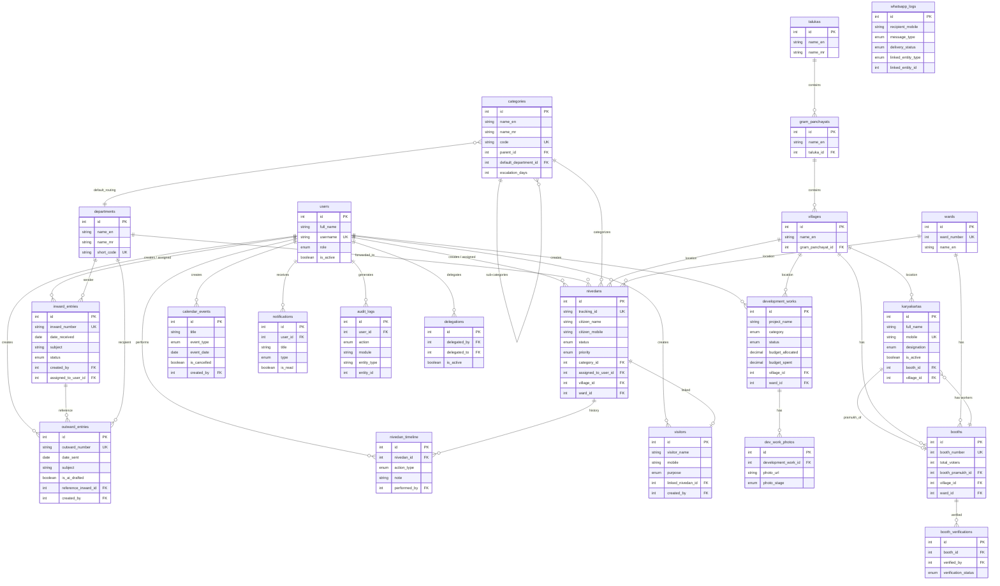

---

## 3. Module-Wise ER Diagrams

### 3A. Inward & Outward Module

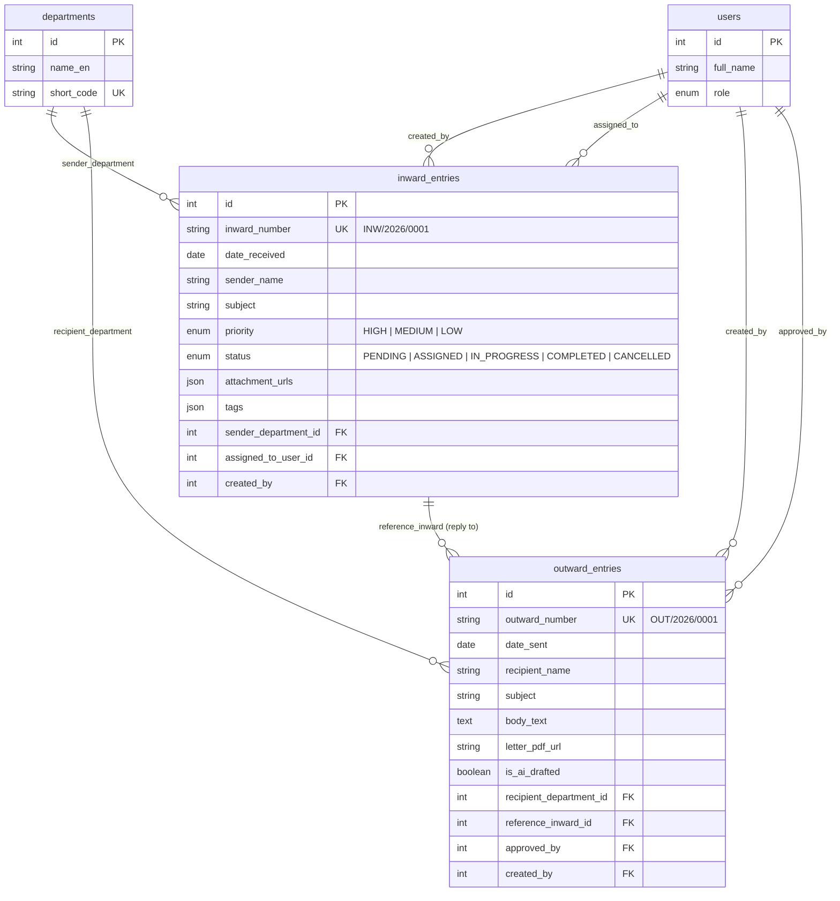

**Key Relationships:**
- One inward can have **multiple outward replies** (1:N)
- Each inward is created by a **Receptionist or PA** and optionally assigned to a **staff member**
- Outward letters can reference the **inward entry** they are replying to
- Both link to the **departments** master table for sender/recipient classification

---

### 3B. Nivedan (Complaint) Module

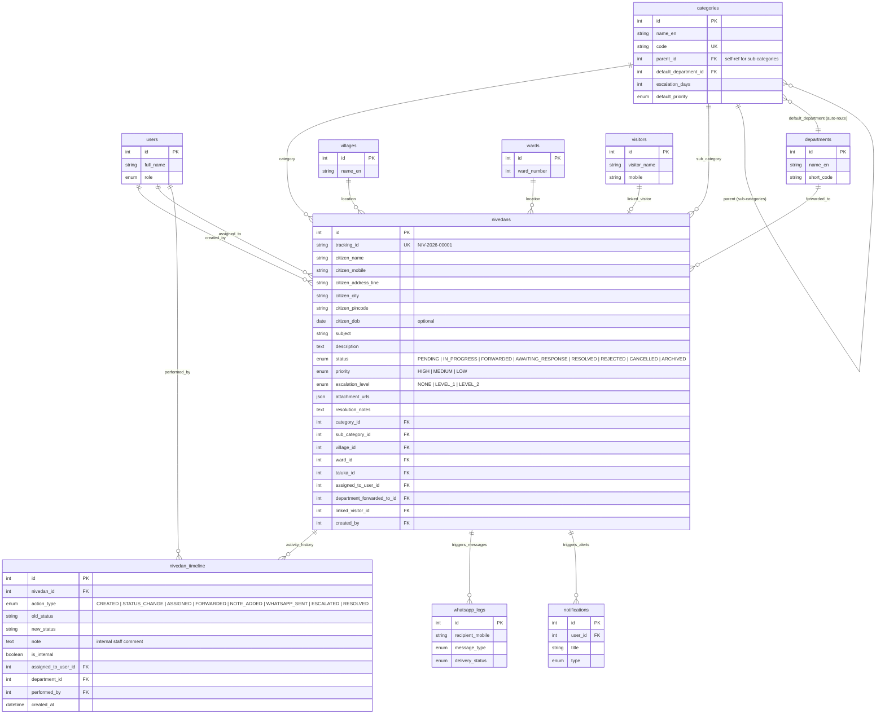

**Key Relationships:**
- Each nivedan belongs to a **category** which has a **default department** for auto-routing
- Categories are **self-referencing** (parent → sub-categories)
- Each nivedan has a **timeline** of activity entries (append-only log)
- A nivedan can be **linked to a visitor** entry (1:1 optional)
- Multiple nivedans from the same citizen are linked by **citizen_mobile** (no FK, query-based)
- Status changes trigger **WhatsApp messages** and **in-app notifications**

---

### 3C. Development Works Module

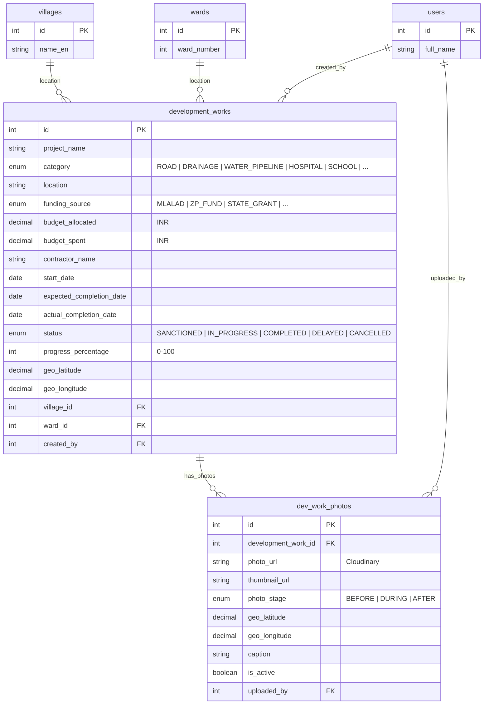

**Key Relationships:**
- Each development work has **many geotagged photos** categorized as Before/During/After (1:N)
- Projects are linked to **village or ward** for area-wise reporting
- Photos store **GPS coordinates** independently for location verification
- Budget is tracked with simple `allocated` vs `spent` columns

---

### 3D. Cadre Network Module (Karyakarta + Booth)

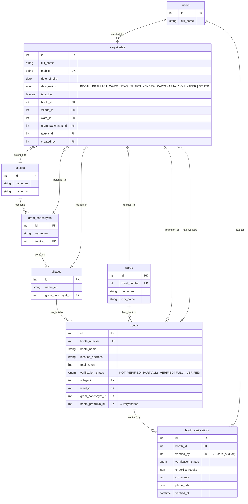

**Key Relationships:**
- **Geographical Hierarchy:** Taluka → Gram Panchayat → Village → Booth (rural) OR City → Ward → Booth (urban)
- Each booth has **many workers** (1:N) and **one Booth Pramukh** (1:1 via `booth_pramukh_id`)
- Each booth can be **verified multiple times** by different auditors
- Workers are linked to both their **booth** and their **geographical location** (village/ward)

---

### 3E. Automation & Intelligence Module (WhatsApp + Notifications + Audit)

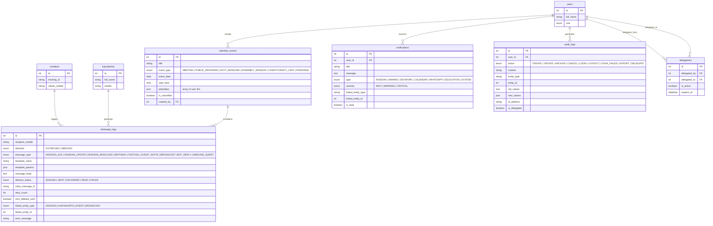

**Key Relationships:**
- `whatsapp_logs` uses **polymorphic linking** (`linked_entity_type` + `linked_entity_id`) to connect to nivedans, karyakartas, or events
- `notifications` also uses **polymorphic linking** for the same reason
- `audit_logs` stores **before/after JSON snapshots** of every data change
- `delegations` links two users (PA → delegate) with auto-expiry

---

## 4. Geographical Hierarchy Diagram

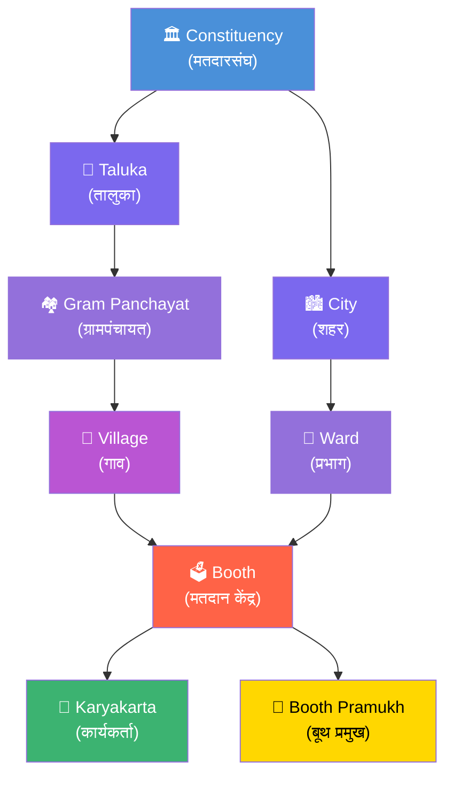

**Table Chain:**
```
talukas (1) ──→ gram_panchayats (N) ──→ villages (N) ──→ booths (N) ──→ karyakartas (N)
                                                                       ──→ booth_pramukh (1)
wards (1) ──────────────────────────────────────────────→ booths (N)
```

---

## 5. Foreign Key Reference Map

Complete listing of every foreign key in the database.

| # | Table | Column | References | On Delete |
|:-:|-------|--------|-----------|-----------|
| 1 | `inward_entries` | `sender_department_id` | `departments.id` | SET NULL |
| 2 | `inward_entries` | `assigned_to_user_id` | `users.id` | SET NULL |
| 3 | `inward_entries` | `created_by` | `users.id` | RESTRICT |
| 4 | `inward_entries` | `updated_by` | `users.id` | SET NULL |
| 5 | `outward_entries` | `recipient_department_id` | `departments.id` | SET NULL |
| 6 | `outward_entries` | `reference_inward_id` | `inward_entries.id` | SET NULL |
| 7 | `outward_entries` | `approved_by` | `users.id` | SET NULL |
| 8 | `outward_entries` | `created_by` | `users.id` | RESTRICT |
| 9 | `nivedans` | `category_id` | `categories.id` | RESTRICT |
| 10 | `nivedans` | `sub_category_id` | `categories.id` | SET NULL |
| 11 | `nivedans` | `village_id` | `villages.id` | SET NULL |
| 12 | `nivedans` | `ward_id` | `wards.id` | SET NULL |
| 13 | `nivedans` | `taluka_id` | `talukas.id` | SET NULL |
| 14 | `nivedans` | `assigned_to_user_id` | `users.id` | SET NULL |
| 15 | `nivedans` | `department_forwarded_to_id` | `departments.id` | SET NULL |
| 16 | `nivedans` | `linked_visitor_id` | `visitors.id` | SET NULL |
| 17 | `nivedans` | `created_by` | `users.id` | RESTRICT |
| 18 | `nivedans` | `updated_by` | `users.id` | SET NULL |
| 19 | `nivedan_timeline` | `nivedan_id` | `nivedans.id` | CASCADE |
| 20 | `nivedan_timeline` | `assigned_to_user_id` | `users.id` | SET NULL |
| 21 | `nivedan_timeline` | `department_id` | `departments.id` | SET NULL |
| 22 | `nivedan_timeline` | `performed_by` | `users.id` | RESTRICT |
| 23 | `visitors` | `village_id` | `villages.id` | SET NULL |
| 24 | `visitors` | `ward_id` | `wards.id` | SET NULL |
| 25 | `visitors` | `linked_nivedan_id` | `nivedans.id` | SET NULL |
| 26 | `visitors` | `created_by` | `users.id` | RESTRICT |
| 27 | `development_works` | `village_id` | `villages.id` | SET NULL |
| 28 | `development_works` | `ward_id` | `wards.id` | SET NULL |
| 29 | `development_works` | `taluka_id` | `talukas.id` | SET NULL |
| 30 | `development_works` | `created_by` | `users.id` | RESTRICT |
| 31 | `development_works` | `updated_by` | `users.id` | SET NULL |
| 32 | `dev_work_photos` | `development_work_id` | `development_works.id` | CASCADE |
| 33 | `dev_work_photos` | `uploaded_by` | `users.id` | RESTRICT |
| 34 | `karyakartas` | `booth_id` | `booths.id` | RESTRICT |
| 35 | `karyakartas` | `village_id` | `villages.id` | SET NULL |
| 36 | `karyakartas` | `ward_id` | `wards.id` | SET NULL |
| 37 | `karyakartas` | `gram_panchayat_id` | `gram_panchayats.id` | SET NULL |
| 38 | `karyakartas` | `taluka_id` | `talukas.id` | SET NULL |
| 39 | `karyakartas` | `created_by` | `users.id` | RESTRICT |
| 40 | `karyakartas` | `updated_by` | `users.id` | SET NULL |
| 41 | `booths` | `village_id` | `villages.id` | SET NULL |
| 42 | `booths` | `ward_id` | `wards.id` | SET NULL |
| 43 | `booths` | `gram_panchayat_id` | `gram_panchayats.id` | SET NULL |
| 44 | `booths` | `booth_pramukh_id` | `karyakartas.id` | SET NULL |
| 45 | `booth_verifications` | `booth_id` | `booths.id` | CASCADE |
| 46 | `booth_verifications` | `verified_by` | `users.id` | RESTRICT |
| 47 | `gram_panchayats` | `taluka_id` | `talukas.id` | RESTRICT |
| 48 | `villages` | `gram_panchayat_id` | `gram_panchayats.id` | RESTRICT |
| 49 | `categories` | `parent_id` | `categories.id` | SET NULL |
| 50 | `categories` | `default_department_id` | `departments.id` | SET NULL |
| 51 | `calendar_events` | `created_by` | `users.id` | RESTRICT |
| 52 | `notifications` | `user_id` | `users.id` | CASCADE |
| 53 | `audit_logs` | `user_id` | `users.id` | RESTRICT |
| 54 | `delegations` | `delegated_by` | `users.id` | RESTRICT |
| 55 | `delegations` | `delegated_to` | `users.id` | RESTRICT |

### On Delete Rules

| Rule | When Used | Meaning |
|------|-----------|---------|
| **RESTRICT** | `created_by`, `performed_by`, core FKs | Cannot deactivate a user if they have records (use `is_active` instead) |
| **SET NULL** | Optional FKs (assigned_to, department, village) | If referenced record is removed, set the FK to NULL |
| **CASCADE** | Child records (timeline, photos, verifications, notifications) | If parent is deleted, delete children too |

> **Note:** Since no records are ever physically deleted in this system (soft-delete only), CASCADE and RESTRICT primarily serve as safety constraints during development/testing.

---

## 6. Data Flow Diagrams

### 6A. Nivedan Creation → Multi-Table Write

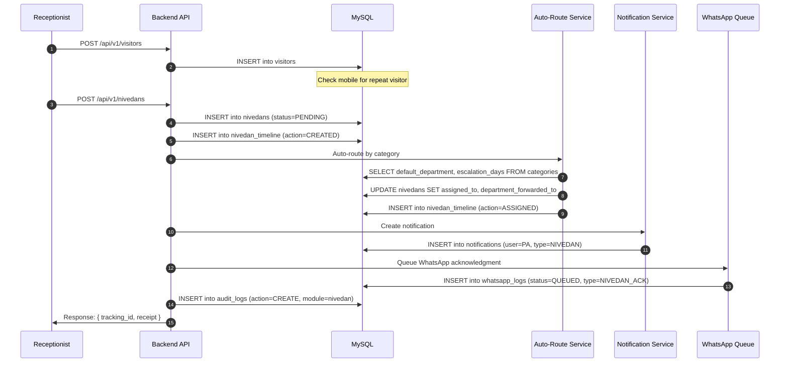

**Tables Written (1 nivedan creation = 6 table writes):**

| # | Table | Records | Purpose |
|:-:|-------|:-------:|---------|
| 1 | `visitors` | 1 | Visitor entry |
| 2 | `nivedans` | 1 | Main complaint record |
| 3 | `nivedan_timeline` | 2 | CREATED + ASSIGNED entries |
| 4 | `notifications` | 1 | Alert to PA |
| 5 | `whatsapp_logs` | 1 | Queued citizen acknowledgment |
| 6 | `audit_logs` | 1 | Audit trail |

---

### 6B. Nivedan Status Change → Cascading Updates

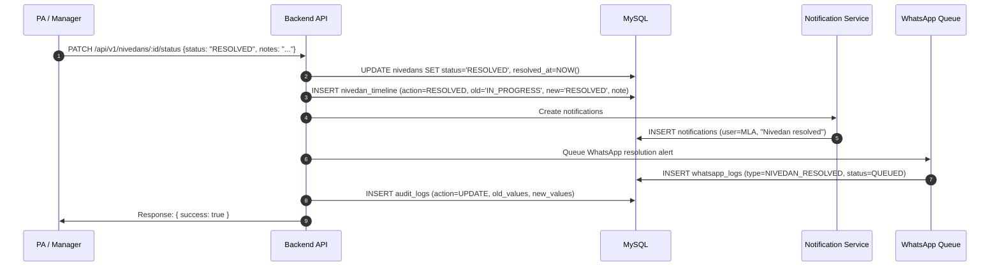

---

### 6C. AI Letter Drafting → Outward Entry Creation

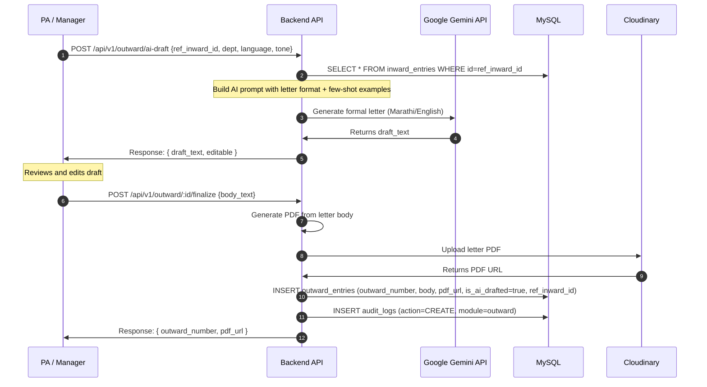

---

### 6D. WhatsApp Webhook → Delivery Status Update

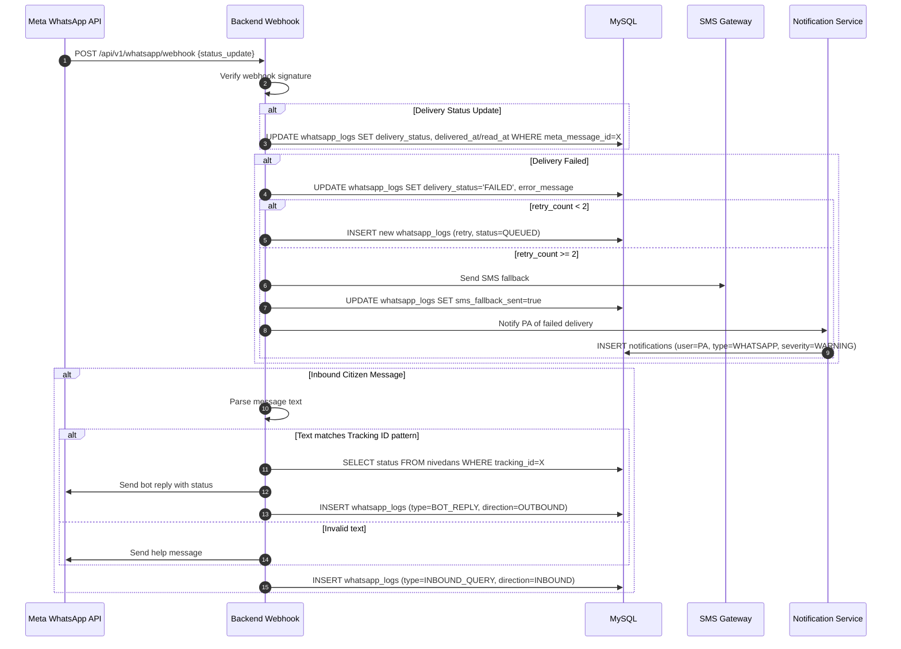

---

### 6E. Daily Escalation Cron → Multi-Table Read/Write

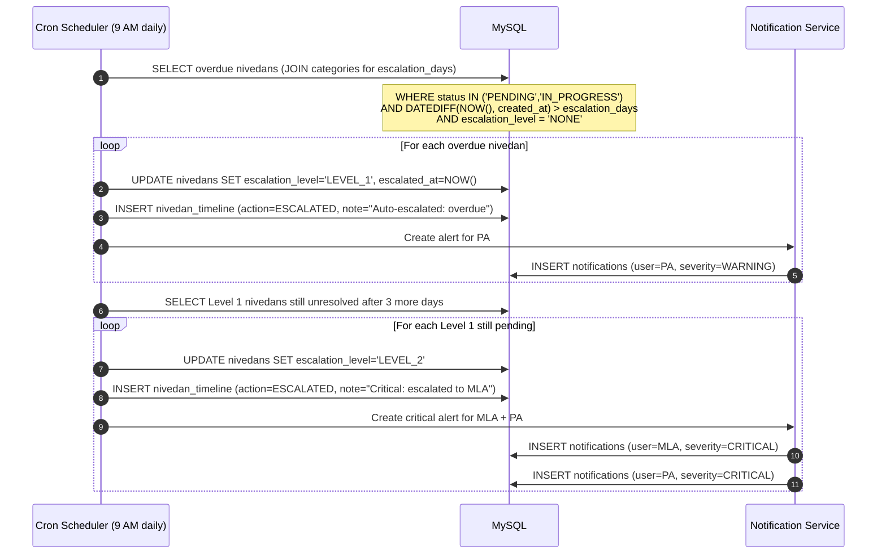

---

### 6F. Birthday Greeting Cron → WhatsApp Queue

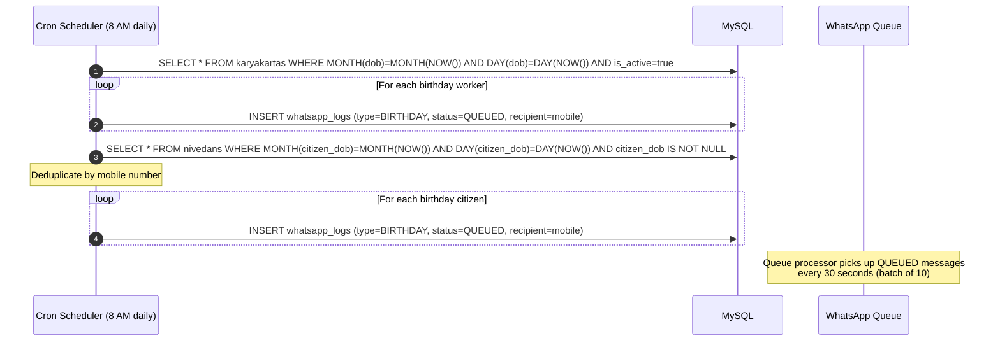

---

## 7. Cardinality Summary

| Relationship | Cardinality | Description |
|-------------|:-----------:|-------------|
| `users` → `nivedans` (created) | 1 : N | One user creates many nivedans |
| `users` → `nivedans` (assigned) | 1 : N | One user can be assigned many nivedans |
| `categories` → `nivedans` | 1 : N | One category has many nivedans |
| `categories` → `categories` | 1 : N | One parent has many sub-categories |
| `categories` → `departments` | N : 1 | Many categories route to one default department |
| `nivedans` → `nivedan_timeline` | 1 : N | One nivedan has many timeline entries |
| `nivedans` ↔ `visitors` | 1 : 1 | One nivedan optionally linked to one visitor |
| `inward_entries` → `outward_entries` | 1 : N | One inward can have many outward replies |
| `development_works` → `dev_work_photos` | 1 : N | One project has many photos |
| `booths` → `karyakartas` | 1 : N | One booth has many workers |
| `booths` ↔ `karyakartas` (pramukh) | 1 : 1 | One booth has one pramukh |
| `booths` → `booth_verifications` | 1 : N | One booth verified multiple times |
| `talukas` → `gram_panchayats` | 1 : N | Geographical hierarchy |
| `gram_panchayats` → `villages` | 1 : N | Geographical hierarchy |
| `villages` → `booths` | 1 : N | One village has many booths |
| `wards` → `booths` | 1 : N | One ward has many booths |
| `users` → `notifications` | 1 : N | One user receives many notifications |
| `users` → `audit_logs` | 1 : N | One user generates many audit entries |
| `users` → `delegations` | 1 : N | PA delegates to multiple users (over time) |

---

## 8. Polymorphic Relationships

Two tables use **polymorphic linking** (type + id pattern) instead of strict foreign keys:

### `whatsapp_logs`

| `linked_entity_type` | `linked_entity_id` points to |
|---------------------|------------------------------|
| `NIVEDAN` | `nivedans.id` |
| `KARYAKARTA` | `karyakartas.id` |
| `EVENT` | `calendar_events.id` |
| `BROADCAST` | Custom broadcast ID or NULL |

### `notifications`

| `linked_entity_type` | `linked_entity_id` points to |
|---------------------|------------------------------|
| `nivedan` | `nivedans.id` |
| `inward_entry` | `inward_entries.id` |
| `development_work` | `development_works.id` |
| `calendar_event` | `calendar_events.id` |
| `user` | `users.id` |

> **Why polymorphic?** These tables receive entries from multiple source modules. Using strict FKs for each would require many nullable FK columns. The type+id pattern is cleaner and extensible.

---
