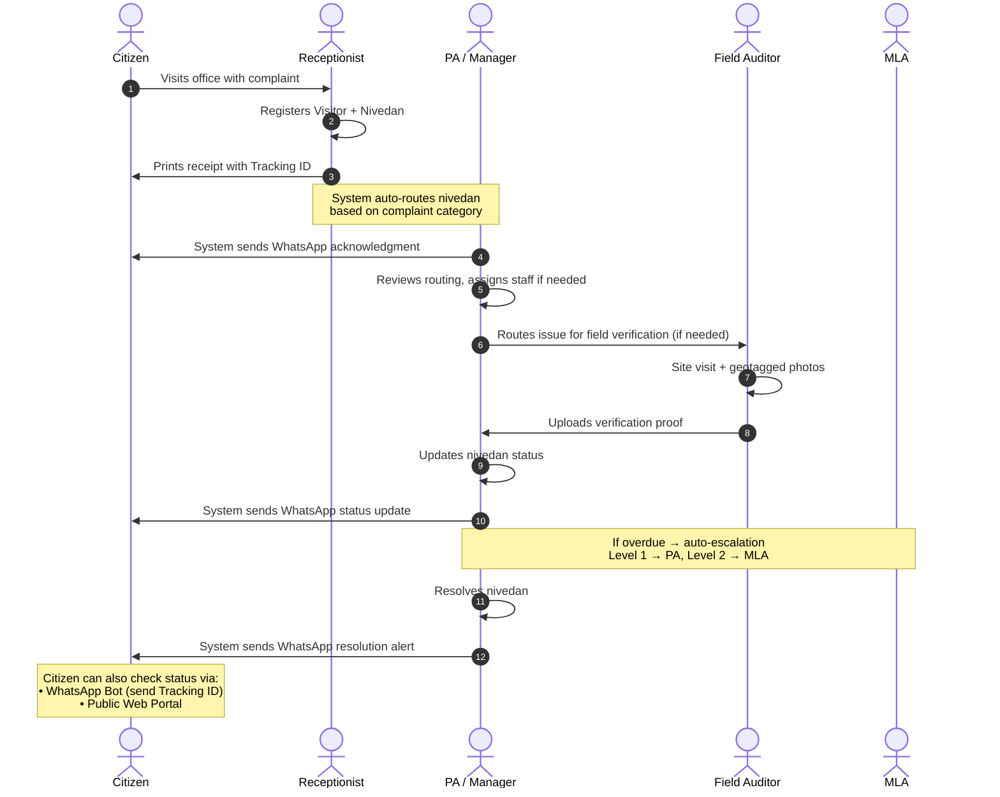

# MLA E-Office — User Roles & Access Control

> **Complete Role Definitions, Permissions Matrix, Daily Workflows, and Security Rules**
> 
> *Related Documents:* [PROJECT_OVERVIEW.md](file:///s:/MLA%20E%20-%20Office/PROJECT_OVERVIEW.md) | [PROJECT_SECTIONS_BREAKDOWN.md](file:///s:/MLA%20E%20-%20Office/PROJECT_SECTIONS_BREAKDOWN.md) | [TECH_STACK.md](file:///s:/MLA%20E%20-%20Office/TECH_STACK.md)

---

## 1. Overview

The MLA E-Office system implements a strict **Role-Based Access Control (RBAC)** architecture with **7 user roles**. Each role has precisely defined module access, data visibility, and action permissions.

### Core Security Principles

| Principle | Rule |
|-----------|------|
| **No Delete** | Nobody can delete records. Data can only be marked as `Cancelled` or `Archived`. This ensures complete data integrity and audit compliance. |
| **Audit Everything** | Every create, update, status change, login, and logout is recorded in the audit trail with user ID, timestamp, and IP address. |
| **Least Privilege** | Each role can only access the modules and actions required for their specific job. |
| **Data Isolation** | Users see only the data relevant to their scope (e.g., Receptionist sees only nivedans they created; Booth Pramukh sees only their booth's workers). |
| **Time-Restricted Access** | Office staff (Receptionist, Auditor) are restricted to office hours. MLA, PA, and Booth Pramukh have 24/7 access. |
| **Delegation Support** | PA can temporarily delegate their permissions to another staff member when absent. |

---

## 2. Typical Office Team Structure

A typical MLA constituency office operates with the following team:

```
┌─────────────────────────────────────────────────────────────┐
│                          MLA                                │
│                  (1 person — Executive Owner)                │
└──────────────────────────┬──────────────────────────────────┘
                           │
              ┌────────────┴────────────┐
              │                         │
    ┌─────────┴─────────┐    ┌─────────┴──────────┐
    │   PA / Manager    │    │   System Admin      │
    │   (1 person)      │    │   (1 person — IT)   │
    └─────────┬─────────┘    └────────────────────┘
              │
    ┌─────────┼──────────────────────┐
    │         │                      │
┌───┴────┐ ┌─┴──────────┐  ┌───────┴────────┐
│Recep-  │ │ Office     │  │ Field Auditors │
│tionist │ │ Staff      │  │ / Assessors    │
│(1-2)   │ │ (3-6)      │  │ (2-3)          │
└────────┘ └────────────┘  └───────┬────────┘
                                   │
                    ┌──────────────┴──────────────┐
                    │      Booth Pramukhs         │
                    │   (200-400 across booths)   │
                    │    WhatsApp Only Access      │
                    └──────────────┬──────────────┘
                                   │
                    ┌──────────────┴──────────────┐
                    │         Citizens            │
                    │  (Public — Tracking Only)   │
                    └─────────────────────────────┘
```

| Role | Typical Count | Platform Access |
|------|:---:|---|
| MLA | 1 | Web (full) + Mobile (future) |
| PA / Manager | 1 | Web (full) + Mobile (future) |
| Front Desk / Receptionist | 1–2 | Web only |
| Office Staff (same permissions as Receptionist) | 3–6 | Web only |
| Field Auditor / Assessor | 2–3 | Web + Mobile (camera/GPS) |
| Booth Pramukh | 200–400 | **WhatsApp only** (no app/web access) |
| System Administrator | 1 | Web only |
| Citizen | Unlimited | Public tracking portal + WhatsApp Bot |

---

## 3. Detailed Role Definitions

---

### 👑 Role 1: MLA (Member of Legislative Assembly)

**Role Type:** Executive Owner & Top Decision-Maker  
**Platform:** Web app (full access) + Mobile app (future)  
**Access Hours:** 24/7 — no time restrictions

#### Primary Responsibilities
- High-level constituency governance and performance monitoring
- Reviewing office dashboard for KPIs and trends
- Tracking major development projects and budget spending
- Reviewing cadre strength and booth-level verification reports
- Checking calendar for upcoming sessions, events, and deadlines

#### System Permissions

| Permission | Level |
|-----------|-------|
| **Overall Access** | Full read access to all 13 modules |
| **Approval Authority** | None required — PA handles all operational approvals |
| **Data Modification** | Can update any record across any module |
| **Data Deletion** | ❌ Cannot delete (no one can — archive/cancel only) |
| **User Management** | Can view user list but cannot create/manage users (Admin only) |
| **Report Export** | Can generate and export all reports (PDF/Excel) |
| **Dashboard** | Full dashboard with all KPI cards, charts, and activity feed |

#### Daily Workflow

1. **Morning Dashboard Review** — Opens dashboard to check overnight updates: new nivedans, visitor count, pending items, escalated complaints
2. **Nivedan Oversight** — Reviews high-priority or long-pending petitions; checks department-wise resolution speed
3. **Development Review** — Tracks constituency infrastructure projects, budget spending, and completion milestones
4. **Cadre Monitoring** — Reviews booth-wise verification reports to gauge party organizational strength
5. **Calendar Check** — Views meeting schedule, assembly sessions, public program invitations
6. **Report Review** — Reviews weekly/monthly summary reports prepared by PA

#### What MLA Does NOT Do
- Does not register nivedans or visitor entries (office staff does this)
- Does not draft outward letters (PA handles this with AI assistance)
- Does not manage user accounts (System Admin does this)
- Does not approve routine actions — PA has full operational authority

---

### 👨‍💼 Role 2: Personal Assistant (PA) / Senior Office Manager

**Role Type:** Operational Head & Office Administrator  
**Platform:** Web app (full access) + Mobile app (future)  
**Access Hours:** 24/7 — no time restrictions

#### Primary Responsibilities
- Day-to-day office operations management
- AI-assisted outward letter drafting and dispatch
- Nivedan routing, assignment, and resolution management
- Calendar management and appointment scheduling
- WhatsApp broadcast approval and dispatch
- Staff task assignment and follow-up
- Report generation for MLA review

#### System Permissions

| Permission | Level |
|-----------|-------|
| **Overall Access** | Full read/write access to all operational modules (12 of 13) |
| **Excluded Module** | ❌ Security & RBAC (System Admin only) |
| **Nivedan** | Create, view all, route, assign, update status, resolve, archive |
| **Inward/Outward** | Create, view, assign, AI draft outward letters, approve and send |
| **Visitor Book** | Create, view all, edit, export |
| **Development Works** | Create, view, update status, update budget, upload photos |
| **Karyakarta Master** | Full CRUD (create, read, update, archive) across all booths/wards |
| **Booth Architecture** | Full read/write, assign Booth Pramukhs, generate reports |
| **Gram/Ward Org** | Full read/write, area management |
| **Calendar** | Full CRUD — schedule, edit, cancel events for MLA and office |
| **WhatsApp Engine** | Compose broadcasts, approve templates, dispatch messages |
| **Dashboard** | Full dashboard view (same as MLA) |
| **Reports** | Generate, view, and export all report types (PDF/Excel) |
| **Notifications** | Receives all office notifications, can configure notification rules |
| **Data Deletion** | ❌ Cannot delete (archive/cancel only) |
| **Delegation** | ✅ Can temporarily delegate PA permissions to another staff member when absent |

#### Delegation Feature

When the PA is absent (leave, travel, illness):
- PA selects a staff member and activates delegation mode
- The delegated staff member temporarily gets PA-level permissions
- All actions by the delegate are logged under their own user ID with a `[DELEGATED]` flag
- PA can revoke delegation remotely at any time
- Delegation auto-expires after a set number of days (configurable: default 3 days)

#### Daily Workflow

1. **Inward Processing** — Reviews incoming paper letters and digital inward entries; scans and uploads if needed
2. **AI Outward Drafting** — Uses Gemini AI to draft formal response letters to government departments (Collector, Tahsildar, ZP, PWD, etc.); reviews and edits AI draft before finalizing
3. **Nivedan Management** — Reviews new nivedans registered by receptionist; routes to correct staff/department; follows up on pending items
4. **Auto-Routing Review** — Checks auto-routed nivedans to verify correct assignment; overrides routing if needed
5. **Calendar Management** — Schedules MLA's appointments, VIP visits, public meetings, and deadlines
6. **WhatsApp Operations** — Approves and dispatches broadcast messages; reviews greeting schedule; handles failed delivery retries
7. **Report Preparation** — Generates weekly/monthly summary reports for MLA review
8. **Staff Coordination** — Assigns tasks to office staff and auditors; follows up on overdue assignments

---

### 🖥️ Role 3: Front Desk Clerk / Receptionist

**Role Type:** Entry-Level Operator & Citizen Liaison  
**Platform:** Web app only  
**Access Hours:** Office hours only (configurable — default 10:00 AM to 6:00 PM)

#### Primary Responsibilities
- Greeting visitors and registering them in the Visitor Book
- Scanning incoming physical letters and uploading to the Inward system
- Registering citizen complaints (nivedans) and issuing tracking receipts
- First point of contact for all citizens visiting the office

#### System Permissions

| Permission | Level |
|-----------|-------|
| **Visitor Book** | ✅ Create new entries, view own entries, print receipts |
| **Nivedan** | ✅ Create new nivedans, view **only nivedans they created**, print tracking receipt |
| **Nivedan Restriction** | ❌ Cannot view nivedans created by other staff; ❌ Cannot change nivedan status or route |
| **Inward** | ✅ Create new inward entries, upload scanned PDFs, view own entries |
| **Inward Restriction** | ❌ Cannot assign inward entries to staff (PA does this) |
| **Outward** | ❌ No access |
| **Development Works** | ❌ No access |
| **Karyakarta Master** | ❌ No access |
| **Booth Architecture** | ❌ No access |
| **Gram/Ward Org** | ❌ No access |
| **Calendar** | 👁️ View only (can see office events but cannot create/edit) |
| **WhatsApp Engine** | ❌ No access |
| **Dashboard** | ❌ No access |
| **Reports** | ❌ No access |
| **Notifications** | ✅ Receives notifications related to their own created entries only |
| **User Management** | ❌ No access |
| **Data Deletion** | ❌ Cannot delete (archive/cancel only) |

#### Nivedan Creation Restriction

> **Important Rule:** Only the **Receptionist** and **PA** can create new nivedans. Other office staff cannot register complaints. This ensures a single controlled entry point for citizen grievances.

#### Daily Workflow

1. **Visitor Registration** — Welcomes every visitor; enters their name, mobile, address, purpose of visit, and arrival time into the Visitor Book
2. **Inward Letter Processing** — Receives physical letters; scans them as PDF; logs inward number, date, sender details, subject, and uploads the scanned file
3. **Nivedan Registration** — Enters citizen complaints with all details (name, mobile, address, village/ward, subject, category, attachments); generates a unique **Tracking ID**; prints a receipt for the citizen
4. **Citizen Communication** — Informs citizens about the WhatsApp tracking feature; explains how they can check status using their Tracking ID
5. **Checkout** — Updates visitor departure time when visitors leave

---

### 🕵️‍♂️ Role 4: Field Auditor / Assessor / Supervisor

**Role Type:** Ground Inspector & Verification Officer  
**Platform:** Web app + Mobile app (camera & GPS required for fieldwork)  
**Access Hours:** Office hours (configurable — default 10:00 AM to 6:00 PM)

#### Primary Responsibilities
- Physical site inspection of development work projects
- Capturing geotagged photo evidence of construction progress
- Updating development work status and progress percentage
- Booth-level verification — confirming completed ground work
- Submitting verification reports with photo proof

#### System Permissions

| Permission | Level |
|-----------|-------|
| **Development Works** | ✅ View assigned projects, update status, update progress %, upload geotagged photos |
| **Dev Works Restriction** | ❌ Cannot create new projects (PA only); ❌ Cannot modify budget |
| **Booth Verification** | ✅ Submit verification reports, upload evidence photos, update booth work status |
| **Gram/Ward Org** | 👁️ View only (for reference during field visits) |
| **Nivedan** | 👁️ View nivedans assigned/forwarded to them for field verification only |
| **Nivedan Restriction** | ❌ Cannot create nivedans; ❌ Cannot change nivedan status |
| **Visitor Book** | ❌ No access |
| **Inward/Outward** | ❌ No access |
| **Karyakarta Master** | ❌ No access |
| **Calendar** | 👁️ View only |
| **WhatsApp Engine** | ❌ No access |
| **Dashboard** | ❌ No access |
| **Reports** | ❌ No access |
| **Notifications** | ✅ Receives notifications for assigned inspections and verification tasks |
| **Data Deletion** | ❌ Cannot delete (archive/cancel only) |

#### Mobile App Features (Field Use)

| Feature | Purpose |
|---------|---------|
| **Camera with GPS tagging** | Capture site photos with automatic geo-coordinates |
| **Offline mode** | Save inspection data locally when no internet; auto-sync when back online |
| **Photo gallery upload** | Upload multiple photos per project visit (Before/During/After) |
| **Status quick-update** | Quickly update project stage: Sanctioned → In Progress → Completed |
| **Progress slider** | Update completion percentage (0%–100%) |

#### Daily Workflow

1. **Check Assignments** — Reviews assigned development work inspections and booth verification tasks for the day
2. **Site Visit** — Travels to infrastructure project sites (road laying, water tank, school renovation, etc.)
3. **Evidence Capture** — Takes geotagged photos showing current construction progress from multiple angles
4. **Status Update** — Updates project status (`Sanctioned` → `In Progress` → `Completed`) and progress percentage
5. **Booth Verification** — Visits polling booth areas to verify whether assigned party tasks and local public works are completed
6. **Report Submission** — Uploads all photos and updates to the system; verification report is auto-generated

---

### 🚩 Role 5: Booth Pramukh (Polling Booth Head)

**Role Type:** Ground Cadre Leader  
**Platform:** **WhatsApp only** — no web or mobile app access  
**Access Hours:** 24/7 (WhatsApp-based, always accessible)

#### Why WhatsApp Only?

Booth Pramukhs are ground-level party workers (200–400 per constituency) who typically:
- May not be tech-savvy or comfortable with web/mobile apps
- Don't have laptops — only smartphones
- Are already heavy WhatsApp users
- Need a zero-learning-curve interface

All their interactions happen via **WhatsApp messages** sent to/from the MLA office WhatsApp number.

#### System Permissions

| Permission | Level |
|-----------|-------|
| **Karyakarta Master** | ✅ Add new workers to **their booth only** (no approval needed — directly added) |
| **Karyakarta Scope** | ❌ Cannot see or modify workers from other booths |
| **Local Issues** | ✅ Submit local village/booth-level complaints to the MLA office via WhatsApp |
| **Nivedan** | ❌ Cannot access the nivedan system directly |
| **All Other Modules** | ❌ No access |
| **Receives** | ✅ WhatsApp broadcasts, event invitations, greeting messages, task alerts |

#### Worker Addition Rule

> **Important:** When a Booth Pramukh adds a new party worker, the worker is added **directly without approval**. No PA/MLA verification is required. This keeps the process fast and friction-free at the ground level. The PA can review and clean up worker data periodically.

#### WhatsApp Interaction Commands

| Booth Pramukh Sends | System Response |
|---------------------|----------------|
| `ADD WORKER <Name>, <Mobile>, <Village>` | Confirms worker added to their booth |
| `MY BOOTH` | Returns booth worker count and list summary |
| `REPORT <issue description>` | Logs a local issue and sends confirmation with tracking number |
| `STATUS <tracking ID>` | Returns current status of a reported issue |

#### What They Receive (Outbound)

| Message Type | When |
|-------------|------|
| Event invitations | When MLA office schedules a rally, meeting, or public event |
| Task assignments | When PA assigns booth-level tasks |
| Greeting messages | Birthday wishes, festival greetings |
| Broadcast updates | Important constituency announcements |
| Verification requests | When field auditor needs booth-level confirmation |

---

### 🙋‍♂️ Role 6: Citizen / Constituent (External User)

**Role Type:** Public User & Beneficiary  
**Platform:** Public web tracking portal + WhatsApp Bot  
**Access Hours:** 24/7  
**Authentication:** None required — access via Tracking ID only

#### Primary Responsibilities
- Submits complaints **in person** at the MLA office (registered by Receptionist)
- Tracks complaint resolution status online or via WhatsApp

#### System Permissions

| Permission | Level |
|-----------|-------|
| **Nivedan Tracking** | ✅ View status of **their own complaint only** using Tracking ID |
| **Submission** | ❌ Cannot submit complaints online (must visit office in person) |
| **All Modules** | ❌ No access to any internal system module |
| **Login** | ❌ No login account — access via Tracking ID only |

#### How Citizens Interact

**Method 1: Public Web Tracking Portal**
- A simple public web page (no login required)
- Citizen enters their **Tracking ID** (e.g., `NIV-2026-00001`)
- System displays: complaint subject, current status, last action date, department handling it
- No other data is visible (citizen details, internal notes, etc. are hidden)

**Method 2: WhatsApp Bot**
- Citizen sends their Tracking ID to the MLA office WhatsApp number
- Bot auto-replies with the current status of their complaint
- Example: Citizen sends `NIV-2026-00001` → Bot replies: *"आपली तक्रार क्र. NIV-2026-00001 सध्या 'कार्यवाही सुरू' या स्थितीत आहे. विभाग: जिल्हाधिकारी कार्यालय."*

**Method 3: Automated WhatsApp Notifications (Passive)**
- Citizens automatically receive WhatsApp messages at each status change:
  - ✅ Acknowledgment (when complaint is registered)
  - ✅ Status update (when status changes)
  - ✅ Resolution confirmation (when complaint is resolved)
- SMS backup sent if WhatsApp delivery fails

#### Future Scope (Post-MVP)
- Citizen self-service complaint submission via web portal
- Complaint submission via WhatsApp chat
- Satisfaction rating after resolution

---

### 🛠️ Role 7: System Administrator (IT Admin)

**Role Type:** Technical Admin & System Maintainer  
**Platform:** Web app only  
**Access Hours:** 24/7

#### Primary Responsibilities
- User account creation, deactivation, and role assignment
- RBAC permission configuration
- System health monitoring and maintenance
- API integration management (WhatsApp, Gemini AI, Cloudinary)
- Security audit log review
- Database backup verification

#### System Permissions

| Permission | Level |
|-----------|-------|
| **User Management** | ✅ Full control — create, edit, deactivate, assign roles, reset passwords |
| **RBAC Configuration** | ✅ Configure module access per role, manage permission tiers |
| **Audit Logs** | ✅ Full read access — view all user activity logs, login history, data changes |
| **System Settings** | ✅ API keys, WhatsApp config, AI config, Cloudinary config, SMTP settings |
| **Database** | ✅ Backup management, migration execution |
| **Office Data Access** | ❌ **Cannot see office operational data** (nivedans, inward/outward, visitors, workers, development works) |
| **Dashboard** | ✅ System health dashboard only (server status, storage usage, API quotas) — NOT the office KPI dashboard |
| **Reports** | ❌ No access to office reports |
| **WhatsApp Engine** | ⚙️ API configuration only — cannot compose or send messages |
| **Calendar** | ❌ No access |
| **Data Modification** | ❌ Cannot create, edit, or archive any office data |
| **Data Deletion** | ❌ Cannot delete (no one can) |

#### Why No Office Data Access?

The System Admin is a **technical role**, not an operational one. They maintain the system infrastructure but should not have visibility into sensitive office data like citizen complaints, political worker information, or the MLA's calendar. This separation ensures data privacy and prevents misuse.

#### Daily Workflow

1. **User Onboarding** — Creates new staff, PA, or auditor accounts when office hires new employees
2. **Account Deactivation** — Disables accounts for employees who leave
3. **Role Assignment** — Configures exact module access for each staff member based on their job function
4. **Audit Trail Review** — Monitors security logs for unauthorized access attempts or suspicious data modifications
5. **System Health Check** — Verifies API connections (WhatsApp, Gemini, Cloudinary), database backup status, and storage usage
6. **Troubleshooting** — Resolves technical issues reported by office staff (login problems, upload failures, etc.)

---

## 4. Complete Permissions Matrix

### Module-Level Access

| Module | MLA | PA | Receptionist | Auditor | Booth Pramukh | Citizen | Admin |
|:---|:---:|:---:|:---:|:---:|:---:|:---:|:---:|
| **Dashboard (Office KPIs)** | 👁️ Full | 👁️ Full | ❌ | ❌ | ❌ | ❌ | ❌ |
| **Dashboard (System Health)** | ❌ | ❌ | ❌ | ❌ | ❌ | ❌ | 👁️ Full |
| **Inward Register** | 👁️ Full | ✍️ Full | ✍️ Create Only | ❌ | ❌ | ❌ | ❌ |
| **Outward Register** | 👁️ Full | ✍️ Full + AI | ❌ | ❌ | ❌ | ❌ | ❌ |
| **Nivedan** | 👁️ Full | ✍️ Full | ✍️ Create + Own View | 👁️ Assigned Only | ❌ | 👁️ Own Tracking | ❌ |
| **Visitor Book** | 👁️ Full | ✍️ Full | ✍️ Create + Own View | ❌ | ❌ | ❌ | ❌ |
| **Development Works** | 👁️ Full | ✍️ Full | ❌ | 📷 Inspect + Upload | ❌ | ❌ | ❌ |
| **Karyakarta Master** | 👁️ Full | ✍️ Full | ❌ | ❌ | ✍️ Own Booth | ❌ | ❌ |
| **Booth Architecture** | 👁️ Full | ✍️ Full | ❌ | ✍️ Verify | ✍️ Own Booth | ❌ | ❌ |
| **Gram/Ward Org** | 👁️ Full | ✍️ Full | ❌ | 👁️ View | ❌ | ❌ | ❌ |
| **Calendar** | 👁️ Full | ✍️ Full | 👁️ View | 👁️ View | ❌ | ❌ | ❌ |
| **WhatsApp Engine** | 👁️ Full | ✍️ Broadcast | ❌ | ❌ | 📩 Receive | 📩 Receive | ⚙️ Config |
| **Reports & Analytics** | 📊 Full | 📊 Full | ❌ | ❌ | ❌ | ❌ | ❌ |
| **Notification Center** | 🔔 All | 🔔 All | 🔔 Own | 🔔 Assigned | ❌ | ❌ | 🔔 System |
| **User Management** | 👁️ View | ❌ | ❌ | ❌ | ❌ | ❌ | 🔑 Full |
| **Security & RBAC** | 👁️ View | ❌ | ❌ | ❌ | ❌ | ❌ | 🔑 Full |
| **Audit Logs** | 👁️ View | ❌ | ❌ | ❌ | ❌ | ❌ | 👁️ Full |

### Action-Level Permissions

| Action | MLA | PA | Receptionist | Auditor | Booth Pramukh | Admin |
|:---|:---:|:---:|:---:|:---:|:---:|:---:|
| Create Nivedan | ❌ | ✅ | ✅ | ❌ | ❌ | ❌ |
| Route/Assign Nivedan | ✅ | ✅ | ❌ | ❌ | ❌ | ❌ |
| Change Nivedan Status | ✅ | ✅ | ❌ | ❌ | ❌ | ❌ |
| Resolve/Archive Nivedan | ✅ | ✅ | ❌ | ❌ | ❌ | ❌ |
| Create Inward Entry | ❌ | ✅ | ✅ | ❌ | ❌ | ❌ |
| Assign Inward to Staff | ✅ | ✅ | ❌ | ❌ | ❌ | ❌ |
| Draft Outward (AI) | ❌ | ✅ | ❌ | ❌ | ❌ | ❌ |
| Register Visitor | ❌ | ✅ | ✅ | ❌ | ❌ | ❌ |
| Create Dev Work Project | ✅ | ✅ | ❌ | ❌ | ❌ | ❌ |
| Update Dev Work Status | ✅ | ✅ | ❌ | ✅ | ❌ | ❌ |
| Upload Geotagged Photos | ❌ | ✅ | ❌ | ✅ | ❌ | ❌ |
| Modify Budget | ✅ | ✅ | ❌ | ❌ | ❌ | ❌ |
| Add Party Worker | ✅ | ✅ | ❌ | ❌ | ✅ (own booth) | ❌ |
| Assign Booth Pramukh | ✅ | ✅ | ❌ | ❌ | ❌ | ❌ |
| Send WhatsApp Broadcast | ❌ | ✅ | ❌ | ❌ | ❌ | ❌ |
| Create Calendar Event | ✅ | ✅ | ❌ | ❌ | ❌ | ❌ |
| Generate Reports | ✅ | ✅ | ❌ | ❌ | ❌ | ❌ |
| Export PDF/Excel | ✅ | ✅ | ❌ | ❌ | ❌ | ❌ |
| Create User Account | ❌ | ❌ | ❌ | ❌ | ❌ | ✅ |
| Deactivate User | ❌ | ❌ | ❌ | ❌ | ❌ | ✅ |
| Configure RBAC | ❌ | ❌ | ❌ | ❌ | ❌ | ✅ |
| View Audit Logs | ✅ | ❌ | ❌ | ❌ | ❌ | ✅ |
| Delegate Permissions | ❌ | ✅ | ❌ | ❌ | ❌ | ❌ |
| Delete Any Record | ❌ | ❌ | ❌ | ❌ | ❌ | ❌ |

---

## 5. Access Time Restrictions

| Role | Access Window | Configurable? |
|------|-------------|:---:|
| MLA | 24/7 — unrestricted | ❌ Always on |
| PA / Manager | 24/7 — unrestricted | ❌ Always on |
| Receptionist | Office hours only (default: 10:00 AM – 6:00 PM) | ✅ Admin configurable |
| Office Staff | Office hours only (default: 10:00 AM – 6:00 PM) | ✅ Admin configurable |
| Field Auditor | Office hours only (default: 10:00 AM – 6:00 PM) | ✅ Admin configurable |
| Booth Pramukh | 24/7 (WhatsApp-based — always accessible) | ❌ Always on |
| Citizen | 24/7 (Public portal + WhatsApp bot) | ❌ Always on |
| System Admin | 24/7 — unrestricted | ❌ Always on |

**Behavior when accessing outside allowed hours:**
- Login attempt is blocked with message: *"Access restricted. Please log in during office hours (10:00 AM – 6:00 PM)."*
- The blocked login attempt is logged in the audit trail
- Admin can override hours for specific staff members if needed (e.g., extend hours during assembly sessions)

---

## 6. Nivedan Escalation Rules

The system implements **auto-escalation** for nivedans that haven't been acted on within a configurable deadline.

### Escalation Flow

```
                    Nivedan Created
                         │
                         ▼
              ┌─────────────────────┐
              │  Assigned to Staff  │
              │  (by Auto-Route     │
              │   or PA manual)     │
              └──────────┬──────────┘
                         │
                  No action in X days?
                         │
              ┌──────────┴──────────┐
              │  YES                │  NO → Normal flow continues
              ▼                     │
    ┌─────────────────────┐         │
    │ LEVEL 1 ESCALATION  │         │
    │ → Notify PA with    │         │
    │   "Overdue" alert   │         │
    └──────────┬──────────┘         │
               │                    │
        Still no action             │
        in X more days?             │
               │                    │
    ┌──────────┴──────────┐         │
    │  YES                │         │
    ▼                     │         │
    ┌─────────────────────┐         │
    │ LEVEL 2 ESCALATION  │         │
    │ → Notify MLA with   │         │
    │   "Critical" alert  │         │
    │ → Dashboard flag     │         │
    └─────────────────────┘         │
```

### Escalation Configuration

| Setting | Detail |
|---------|--------|
| **Deadline Type** | Configurable per nivedan **category** (different complaint types have different urgency) |
| **Default Deadline** | 5 days (if no category-specific config) |
| **Level 1 → PA** | Triggered when deadline passes with no status change |
| **Level 2 → MLA** | Triggered if Level 1 notification is ignored for an additional configurable period (default: 3 more days) |
| **Notification Channel** | In-app notification + email (if configured) |
| **Dashboard Flag** | Escalated nivedans are highlighted in red on the dashboard |
| **Auto-Reassignment** | ❌ No — escalation only sends alerts. PA must manually reassign if needed. |

### Example Category Deadlines

| Nivedan Category | Deadline (Days) | Urgency |
|-----------------|:---:|:---:|
| Water Supply | 3 | 🔴 High |
| Electricity | 3 | 🔴 High |
| Road / Drainage | 7 | 🟡 Medium |
| Land / Revenue | 10 | 🟢 Normal |
| Education | 5 | 🟡 Medium |
| Health / Medical | 3 | 🔴 High |
| Pension / Ration Card | 7 | 🟡 Medium |
| Certificate / Document | 5 | 🟡 Medium |
| General / Other | 7 | 🟡 Medium |

---

## 7. User Interaction Workflow



---

## 8. Authentication & Session Rules

| Rule | Detail |
|------|--------|
| **Login Method** | Username + Password |
| **Password Requirements** | Minimum 8 characters, at least 1 uppercase, 1 number |
| **Token Type** | JWT access token (expires: 24 hours) + Refresh token (expires: 7 days) |
| **Session Timeout** | Auto-logout after 30 minutes of inactivity (configurable by Admin) |
| **Failed Login Lockout** | Account locked for 15 minutes after 5 consecutive failed attempts |
| **Password Reset** | System Admin resets password manually (no self-service for MVP) |
| **Concurrent Sessions** | Allowed — user can log in from multiple devices simultaneously |
| **Remember Me** | Optional — extends session to 7 days (refresh token) |
| **Audit** | Every login, logout, and failed attempt is logged with timestamp and IP |

---

## 9. Notification Rules by Role

| Event | MLA | PA | Receptionist | Auditor | Citizen |
|:---|:---:|:---:|:---:|:---:|:---:|
| New nivedan registered | ❌ | 🔔 | ❌ | ❌ | ✅ WhatsApp ack |
| Nivedan assigned to staff | ❌ | 🔔 | ❌ | 🔔 (if assigned) | ❌ |
| Nivedan status changed | ❌ | 🔔 | ❌ | ❌ | ✅ WhatsApp |
| Nivedan resolved | ❌ | 🔔 | ❌ | ❌ | ✅ WhatsApp |
| Nivedan overdue (Level 1) | ❌ | 🔔 🔴 | ❌ | ❌ | ❌ |
| Nivedan overdue (Level 2) | 🔔 🔴 | 🔔 🔴 | ❌ | ❌ | ❌ |
| New inward entry | ❌ | 🔔 | ❌ | ❌ | ❌ |
| Calendar event reminder | 🔔 | 🔔 | 🔔 | 🔔 | ❌ |
| Dev work status changed | 🔔 | 🔔 | ❌ | 🔔 | ❌ |
| WhatsApp delivery failed | ❌ | 🔔 | ❌ | ❌ | ❌ |
| New user account created | ❌ | ❌ | ❌ | ❌ | ❌ |
| System alert (storage/API) | ❌ | ❌ | ❌ | ❌ | ❌ |

**🔔** = In-app notification (bell icon)  
**🔴** = High-priority alert (red badge, email backup)  
**✅** = WhatsApp/SMS message

---

## 10. Data Visibility Scope Summary

| Role | What They Can See |
|------|-------------------|
| **MLA** | Everything across all modules, all areas, all time periods |
| **PA** | Everything except Security & RBAC settings |
| **Receptionist** | Only records **they personally created** (own nivedans, own visitor entries, own inward entries) |
| **Auditor** | Only development works and nivedans **assigned to them** for inspection |
| **Booth Pramukh** | Only workers in **their specific booth** (via WhatsApp) |
| **Citizen** | Only **their own complaint status** (via Tracking ID) |
| **Admin** | Only system settings, user accounts, and audit logs — **no office data** |

---

👑 MLA	mla	Pa@12345	Executive Owner (Full Dashboard & Governance)
👨‍💼 PA	pa	Pa@12345	Senior Office Manager (Pending Nivedans, Inward, AI Outward)
🖥️ RECEPTIONIST	receptionist	Pa@12345	Front Desk Clerk (Today's Visitors, Nivedan Registration)
🕵️‍♂️ AUDITOR	auditor	Pa@12345	Field Inspector (DevWorks Progress & Booth Verification)
⚙️ ADMIN	admin	Pa@12345	System Administrator (User & Audit Management)
